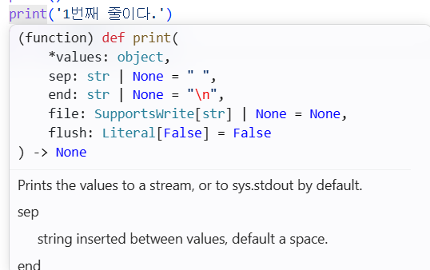

# python기초

- 사용 교재: [점프 투 파이썬]([https://wikidocs.net/book/1](https://wikidocs.net/book/1))

# 1. 개발환경 구축

- python, vscode 설치
- 데이터사이언스 기초
- 터미널 사용법

# 기초 문법

## print()

- 정의




- print 함수 사용하기

```python
print('first text')

# () 안에 함수 대상(매개변수)

# 단독 실행
print('aaaaaa')
```

#### 따옴표 쓰는 이유

- 문자열은 따옴표로 묶어준다
- 따옴표 안쓰고 단어 하나 치면 변수로 취급해버림

#### 숫자와 문자

- 숫자:
- 문자: 따옴표로 감싸주기
    - 따옴표 없으면 에러(파이썬이 따옴표 없는 문자를 변수로 인식)
    
    ```python
    print(hello)
    ```
    
    ```
    Traceback (most recent call last):
      File "c:\Users\Admin\Desktop\workspace\str_and_num.py", line 9, in <module>
        print(hello)
              ^^^^^
    NameError: name 'hello' is not defined. Did you mean: 'help'?
    ```
    
    - 큰따옴표, 작은 따옴표 상관 없음(” 또는 ‘)
    - 만약 따옴표 쌍이 서로 다르면 에러 발생

```python
# 숫자: 100
# 문자: 'ㅁㅁㅁㅁㅁㅁ'

print(100)
print('aaaaaa')
print("aaaaaa")

#print('aaaaa") # 오류!
```

## 주석

- 파이썬 한 줄에 #를 붙이면 파이썬이 실행 대상이 아니라고 판단
- 코드를 설명하는 등 메모를 남길 때 유용
- 코드 여러 줄을 선택하고 ctrl+/ 누르면 주석으로 변경됨
- 

## 여러가지 출력

- print() 함수는 한 줄에 여러 변수 출력 가능

```python
print('여러 변수 출력')
print(100, 100, 200)
```

```
여러 변수 출력
100 100 200
```

## 줄바꿈 이해하기

- print()는 출력 후 줄바꿈
- 만약 print()에 아무 매개변수를 안주고 쓰면 그냥 줄바꿈을 해줌

```python
print(100)
print('a')
print(100, 200, 300)

print()
print()
print(400)
```

```
100
a
100 200 300

400
```

> 
> 
> 
> #### print() 함수 설명 중
> 
> **end**
> 
> string appended after the last value, default a newline.
> 

## 여러줄 텍스트 쓰기

- 따옴표 3개로 여러 줄을 감싸면 문자열로 인식
- 줄바꿈도 인식해줌
- 주석으로도 쓰기도 함

```python
# 따옴표 3개

'''
대충
여러 줄인
주석
'''

print('''
aaaaaaa
bbbbbbb
''')
```

```

aaaaaaa
bbbbbbb

```

## 들여쓰기

- 코드 앞부분에 공백을 넣어 코드블럭 구분
- 타 언어의 경우 중괄호({})를 사용하나 파이썬은 들여쓰기로 구

```c
#include <stdio.h>

int main() {
    int sum = 0;

    // 타 언어(c언어)의 코드블럭
    for (int i=0; i<5; i++){
        sum += i;
   }
    
    printf("%d\n", sum);
    return 0;
}
```

```python
sum = 0

# 파이썬의 코드블럭
for i in range(5):
    sum += i

print(sum)
```

## 문자열 안에 따옴표

- 큰따옴표 안에 작은따옴표를 넣고 싶거나 그 반대의 경우 따옴표 앞에 \(백슬래시) 넣으면 됨(권장)
- 큰따옴표묶음 안에 작은따옴표, 혹은 그 반대도 가능

```python
print('aaaaa')
print("aaaaa")
#print('aaaaa") #에러
#print("aaa'aaa") # 에러
print("aaa\'aaa")
print("Python's favorite food is perl")
```

```
aaaaa
aaaaa
aaa'aaa
Python's favorite food is perl
```