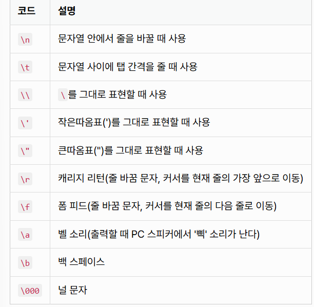

# 변수

- 컴퓨터가 기억할 자료형을 저장
- `변수명 = 자료` 형태로 선언

```python
a = 100
b = 200
c = 3000
print(a, b, c)
```

```
100 200 3000
```

## 여러 줄 문자열을 변수에 대입

- 문자 한 줄에 줄바꿈 넣고 싶으면 '\n' 넣으면 됨

### 이스케이프 코드



## 문자열 연산하기

- 문자열 + 문자열: 문자열 이어붙이기

```python
head = "python"
tail = ' is fun'
print(head + tail)
```

```
python is fun
```

- 문자열 * 정수: 문자열을 정수배 반복

```python
a = 'a'
print(a * 5)
aaaaa
```

```python
print('='*50)
print('My program')
==================================================
My program
```

## len() 자료형 길이


- len(변수): 변수의 길이를 반환

```python
text = 'asdfjadvjavj  aindvaidvp'
print(len(text))

24
```

## 인덱싱&슬라이싱

### 인덱싱

- 인덱싱: 파이썬 문자열(또는 리스트/배열 같은 선형 자료구조)의 순서
- 인덱싱은 0부터 시작
    - a[0]: a의 첫 글자
    - a[1]: a의 두번째 글자
- 인덱스 번호 = -1이면 마지막 글자를 의미
    - a[-1]: a의 마지막 글자
- -1부터 -2, -3, …., -len(string) → 뒤에서 첫번째, 두번째, …, 마지막 인덱스


```python
a = "Life is too short, You need Python"
length = len(a)
# 1, 2, 3번째 글자
print(a[0], a[1], a[2])
print(length)

# 마지막 글자
print(a[length-1])
print(a[-1])

text1 = "안녕하세요"
print(text1[-1])
```

```
L i f
34
n
n
요
```

### 슬라이싱

- 슬라이싱: 시작 인덱스 부터 끝 인덱스 전까지만 표시
    - a[0:4]: a의 첫 번째부터 4번째까지(인덱스 0부터 인덱스 3까지)만 뽑아냄
        - 즉  a[0]+a[1]+a[2]+a[3]을 의미

```python
a = "Life is too short, You need Python"
print(a[0:4])
```

```
Life
```

- 시작 인덱스 생략 시 처음부터 끝 인덱스까지를 의미
- 끝 인덱스 생략 시 시작 인덱스부터 끝까지를 의미
    - 슬라이싱에서 시작/끝 인덱스 모두 없으면 모두 뽑아냄(`a[:]`)

```python
a = 'Pithon'
print(a[:1] + 'y' + a[2:])
```

```python
Python
```

### 인덱싱과 슬라이싱으로 문자열 수정

- 문자열은 인덱싱/슬라이싱으로만 수정 불가
    - 변경불가(immutable) 자료형

```python
a = 'Pithon'
a[1] = 'y'
print(a)
```

```
Traceback (most recent call last):
  File "c:\Users\Admin\Desktop\workspace\variable\slicing.py", line 8, in <module>
    a[1] = 'y'
    ~^^^
TypeError: 'str' object does not support item assignment
```

- 슬라이싱 쓰던가 새로 쓰던가

```python
a = 'Pithon'
print(a[:1] + 'y' + a[2:])
```

```python
Python
```

## 포매팅

- 포매팅: 문자열 안에 변수 집어넣기
    - 형식: 변수 aaa=1일때, “aaa %d aaa”%aaa → aaa 1aaa

```python
print("I eat %d apple"%3)
print("I eat %s apples"%'five')

# 변수
num = 3
print('I eat %d apples'%num)

# 2개 이상 입력
num = 10
day = 'three'
print('I eat %d apples. so I was sick for %s days.'%(num, day))
```

#### 포맷 코드 종류


### 소수점 표현하기

```python
y = 3.141519
print('{0:0.4f}'.format(y))
```

```
3.1415
```

## f 포매팅


- 문자열 안 ‘{}’가 있을 때 format() 메서드 사용 가능
- format 함수를 사용해 문자열을 포매팅할 경우, `{}`와 같은 중괄호 문자를 포매팅 문자가 아닌 문자 그대로 사용하고 싶은 경우에는 위 예의 `{{}}`처럼 2개를 연속해서 사용하면 된다.

```python
print("I eat {0} apples".format(3))
```

```
I eat 3 apples
```

#### 함수와 메서드

- 함수: 점 없이 사용 가능
- 메서드: 객체 뒤 점 찍고 사용. 객체의 행위
- format()은 문자열 관련 함수
    - 문자열에 관련해서 쓸 수 있음
    - 파이썬 자료형들은 클래스 형태, 즉 format 함수는 문자열 객체의 메서

## f 문자열 포매팅

```python
name = "Hong Gildong"
age = 30
print(f'My name is {name} and my age is {age}.')
```

```
My name is Hong Gildong and my age is 30.
```

## 문자열 관련 함수

### count()

- count(): 자료형 내에 특정 자료가 몇 개 있는지 반환

```python
a = 'hobby'
print(a.count('b')) # 'b'가 2개
```

```
2
```

### find()

- find(): 특정 문자의 위치(인덱스) 반환
    - 문자가 없으면 -1 반환

```python
a = "Python is the best choice"
print(a.find('b'))
print(a.find('k'))
```

```
14
-1
```

### index()

- find()와 달리 없는 값 찾으면 에러 발생, 그 외는 find()와 동일

### replace()

- replace(바꿀 문자, 대체할 문자): 문자열 내 바꿀 문자를 대체할 문자로 변

```python
a = "Life is too short"
print(a.replace("Life", "Your leg"))
```

```
Your leg is too short
```

### split()
- split(구분 문자): 문자열을 특정 문자를 기준으로 나눔
    - 리스트 형태로 반환함
    - 매개변수를 아무것도 안주면 공백 기준으로 분리함

```py
a = "Life is too short"
print(a.split())

b = "a:b:c:d"
print(b.split(':'))
```
```
['Life', 'is', 'too', 'short']
['a', 'b', 'c', 'd']
```

### isalpha()
- isalpha(): 문자열이 모두 알파벳인가?
```py
s = 'python'
i = '12345'
print(s.isalpha())
print(i.isalpha())
```
```
True
False
```

### isdigit()
- isdigit(): 문자열이 모두 숫자인가?
```py
s = 'python'
i = '12345'

print(i.isdigit())
print(s.isdigit())
```
```
True
False
```