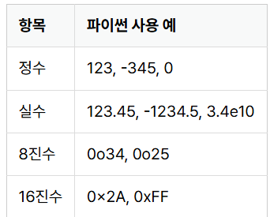

# 숫자형


## 숫자형
### 정수
```py
a = 123
a = -123
a = 0
```

### 실수
```py
a = 1.23
a = -3.45

a = 4.24E10 # 4.24 * 10**10
a = 4.24e-10 # 4.24 * 10 ** (-10)
```

### 8진수, 16진수
```py
a = 0o177
b = 0xABC
```

## 연산
### 사칙연산
+, -, *, /

### 제곱
**
```py
2 ** 2
```
```
4
```
$2^2=4$

### 몫과 나머지
- //: 몫만 반환, 
- %: 나머지
```py
print(7 // 3)
print(7 % 3)
```
```
2
1
```

### 복합 연산자
```py
a = 1
a = a + 1
print(a)
```
를
```py
a = 1
a += 1
```
로 표기
- 복합연산자 종류
    - +=, -=, *=, /=, //=, %=, **=
- 등호가 먼저 나오면 거꾸로 진행
```py
a = 1
a += 1
print(a)

a =+ 1 
print(a)
```
```
2
1
```