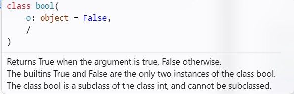

# 불
- bool: 참(True)와 거짓(False)만 가질 수 있는 자료형

```py
a = True
b = False

print(a, type(a)) # type(): 자료형의 유형 반환
print(b, type(b))
```

## 예약어
- 예약어: 파이썬에서 이미 쓰이고 있는 단어. 변수명을 예약어로 사용 불가능
    - 만약 변수명을 예약어로 했다간 문법 오류 발생
- 예약어 목록: True, False, if, else, for ...

#### + 변수명을 함수 이름으로 쓰면...
```py
print = 100
print(print)
```
```
Traceback (most recent call last):
  File "c:\Users\Admin\Desktop\workspace\code\boolean\print_error.py", line 2, in <module>
    print(print)
    ~~~~~^^^^^^^
TypeError: 'int' object is not callable
```
- 예를 들어 print를 변수명으로 쓰면 파이썬은 print를 변수명으로 인식해버림
    - 즉 내장함수를 변수이름으로 쓰면, 파이썬은 내장함수를 더이상 변수이름으로 인식해버림.
- **즉 변수 이름을 정할 때 가급적 내장함수와 겹치지 않게 할 것**

## bool 사용법
- 조건문의 반환값으로 사용
```py
a = 1==1
b = 2 < 1
print(a, b)
```
```
True False
```
- 조건문 예제
    - a=100인데, 조건문에서 a==100이 True이므로 'a' 출력

```py
a = 100

if a == 100:
    print('a')
else:
    print('b')
```
```
a
```

## 자료형의 참과 거짓
- 문자열, 리스트, 튜플, 딕셔너리 등의 값이 비어 있으면("", [], (), {}) 거짓이 되고 비어 있지 않으면 참이 된다. 
- 숫자에서는 그 값이 0일 때 거짓이 된다. 

```py
a = [1, 2, 3, 4]

# a=True일때 반복
# -> a=False, 즉 a가 공백이 될 때 정지
while a:
    print(a.pop()) 

print(a)
```
```
4
3
2
1
[]
```

## 불 연산
- 불 연산을 활용해 참과 거짓 판단

```py
print(bool('python'))
print(bool())
```
True
False

## 논리 연산자
- and: 양쪽 모두 참일때 참
- or: 둘 중 하나 이상 참이면 참
- not: 참/거짓 반전