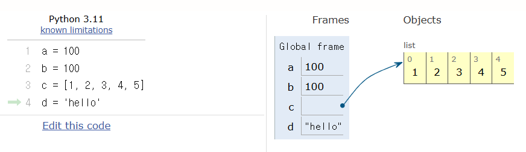

# 변수
## 규칙
1. 영문자, 숫자, 언더스코어(_)만 사용할 수 있다.
2. 숫자로 시작할 수 없다.
3. 예약어는 사용할 수 없다.
    - 예약어 목록
    ```
    False, None, True, and, as, assert, break, class, continue, def, 
    del, elif, else, except, finally, for, from, global, if, import, 
    in, is, lambda, nonlocal, not, or, pass, raise, return, try, 
    while, with, yield
    ```
4. 대소문자를 구분한다.

## 변수명 권장 사항
- 의미 명확히
- 띄어쓰기는 언더스코어

## 변수 저장 과정
- 숫자형이나 문자열은 global frame이라는 연결리스트에 직접 저장
- 리스트의 경우 list객체에 저장되고, Global frame에 list객체를 가지는 포인터가 담김


## 변수란?
- 파이썬에서 변수는 객체를 가리키는 것
    - 숫자든 문자든 리스트이든 모두 객체임

### 객체
- 객체: 기능과 속성으로 묶인 자료형
- 객체 구성 예시(객체와 클래스)

### 리스트 복사
```py
a = [1, 2, 3]
b = a

print(id(a))
print(id(b))

print(a == b)
print(id(a) == id(b))
```
```
1913479822080
1913479822080
True
True
```
- 이런 식으로 리스트를 복사하면 a를 변경하면 b도 같이 변경됨
- b = a[:]나 copy 모듈 이용
```py
from copy import copy

a = [1,2 , 3]
b = copy(a)

print(id(a), id(b))
print(id(a) == id(b))
```
```
1634883240576 1634882091776
False
```