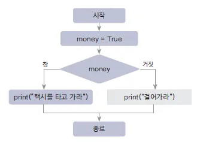
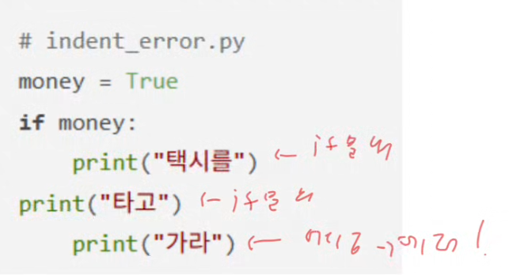
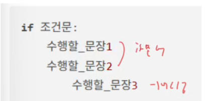
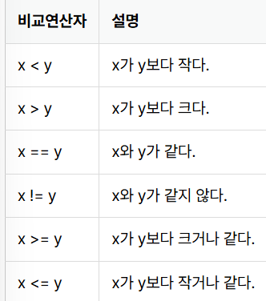
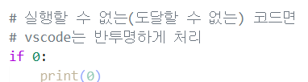
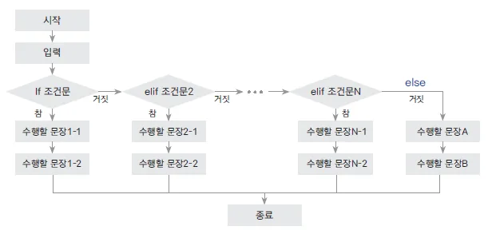

# if
- 극초창기 인공지능은 if-else를 이용한 판단기반이었다고 함

## if문의 필요성
- 프로그래밍에서 조건을 판단하여 해당 조건에 맞는 상황을 수행하는 데 쓰는 것이 바로 if 문이다.



```py
money = True
if money:
    print("택시를 타고 가라")
else:
    print("걸어 가라")
```
```
택시를 타고 가라
```

### 조건식을 이용한 if문

- if 뒤에 조건 써줌
- else는 if의 조건을 만족하지 않을때 실행됨
```py
a = 100

if a > 100:
    print('a는 100보다 큼')
else:
    print('a는 100 이하임')
```
```
a는 100 이하임
```

## 들여쓰기
- `if조건문:` 바로 다음 문장부터 if문에 속하는 모든 문장에 들여쓰기 해야 함
```py
# indent_error.py
money = True
if money:
    print("택시를")
print("타고")
    print("가라")
```
```
  File "c:\Users\Admin\Desktop\workspace\python_basic\day3\code\2_if\3_if_error.py", line 6
    print("가라")
IndentationError: unexpected indent
```


- 들여쓰기는 항상 같은 깊이로 해야 함. 그렇지 않는다면 파이썬은 코드블록 판단을 하지 못해서 들여쓰기오류가 발생함



- 들여쓰기를 시작할 때는(if, for, def, class 등) 콜론(:)을 붙여줘야 함


 ## 조건문 여러개
 - 아래 예시에서 if a>20와 if a>30은 서로 상관이 없음
 ```py
 a = 100


'''
두 if문은 전혀 영향을 주지 않음
if a>20:
'''
if a > 20:
    print('20')
else: print('e')
if a > 30:
    print('30')
```
```
20
30
```

- **if는 단독으로 사용 가능,\
 else는 단독으로 사용 못하고 if와 짝으로 작성 가능**

#### 논리연산자로 묶기
```py
a = 100

if a>20 or a>30:
    print('20')
```
- a는 20보다 크거나 30보다 크다는 조건에 만족하므로 20을 출력


## 조건문이란?
- if조건문에서 '조건문': 참과 거짓을 판단하는 문장

```py
money = True
if money:
```
money=True이기 때문에 조건문은 참

### 비교연산자
- 비교연산자가 맞으면 참, 아니면 거짓


#### 사용 예시
```py
a = 100

# a==100: 만족 -> 실행
if a == 100:
    print(1)

# a*2>100은 참, a-5==0은 거짓
# True and False = False이므로 실행 안함
if a*2 > 100 and a-5 == 0:
    print(2)
```
```
1
```

- [참고: 자료형의 참과 거짓](https://github.com/qlkdkd/Bootcamp_python/blob/main/day2/4_bool/boolean.md#%EC%9E%90%EB%A3%8C%ED%98%95%EC%9D%98-%EC%B0%B8%EA%B3%BC-%EA%B1%B0%EC%A7%93)

```py
if True:
    print(True)

if 100:
    print(100)


# 실행할 수 없는(도달할 수 없는) 코드면
# vscode는 반투명하게 처리
if 0:
    print(0)
else:
    print(0)
```
```
True
100
0
```
- \


## 조건문 안 조건문
- 조건문 안에 조건문 사용 가능
- 조건문 1을 만족하면 그 안의 조건문 2를 또 검사하는 방식
```py
a = 100

if a>50:
    print('50 이상')
    if a>60:
        print('60 이상')
```
```
50 이상
60 이상
```

```py
a = 30

if a > 50:
    print(50)
    if a > 60:
        print(60)
        if a > 70:
            print(70)

else:
    print('else')
```
```
else
````

```py
a = 60

if a > 50:
    print(50)
    if a > 60:
        print(60)
        if a > 70:
            print(70)
        else:
            print('under 70')
    else: print('under 60')
else:
    print('else')
```
```
50
under 60
```

## in, not in
- x in 리스트: x가 리스트 안에 있으면 True, 아니면 False
- x not in 리스트: 결과 반전
    - 꼭 리스트가 아니어도 문자열, 튜플 등 여러 요소를 묶은 데이터 타입이면 가능
```py
x = [1, 2, 3]
print(1 in x); print(1 not in x)
print(5 in x); print(5 not in x)


# in 키워드를 이용한 조건문
if 1 in x:
    print('1 in x')
else:
    print('1 not in x')
```
```
True
False
False
True
1 in x
```

## elif
- if안에 if를 계속 쓰면 가독성 떨어짐
- 또 다른 조건을 추가



- elif는 if문 다음, else 이전에 작성 가능

```py
pocket = ['paper', 'cellphone']
card = True

if 'money' in pocket:
    print("택시를 타고가라")
elif card: 
     print("택시를 타고가라")
else:
     print("걸어가라")
```
```
택시를 타고가라
```

```
if 조건1:
    ~
elif 조건2:
    ~
...
else:
    ....
```
- 위 코드에서 조건 1에 맞으면 `if`문 내, 조건 2에 맞으면 `elif 조건2` 내, ...., 아무 조건에 안맞으면 else문 내부 실행
- 조건문 1세트는 한 블럭만 실행

#### 여러가지 분기 예제
```py
a = 30
speed = 20
car_speed = 20


if a >= 130:
    print('보행 중')

    if speed >= 30:
        print('뛰는 중')
        
        if car_speed > speed:
            print('비상정지')

        else:
            print('서행 경고')

    else: print('걷는 중')

elif a >= 80:
    print('앉은 자세')

elif a >= 10:
    print('엎드려있음')

else:
    print('발견하지 못함')
```
```
엎드려있음
```


### if문 한 줄로 작성
- 조건문 다음에 수행할 문장이 1줄이면 콜론 바로 뒤에 적어도 됨
```py
pocket = ['paper', 'money', 'cellphone']
if 'money' in pocket: pass
else: print("카드를 꺼내라")
```

### pass
- 특정 조건에 맞으면 아무것도 실행하지 않을 때 pass 키워드 사용
```py
a = 50

if a >= 50:
    pass
else:
    print('under 50')
```
```
```

