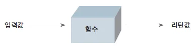
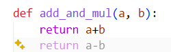

# 함수
- 기능을 묶어놓은 단위
- 수학에서의 함수
$$y = 2x + 3$$
- 입력값 x를 넣으면 출력값 3이 나옴
- **입력값을 주면 출력값이 나오는 것이 함수**
```py
def y(x):
    return 2*x + 3
```

### 파이썬에서의 함수의 종류
- 내장함수(built-in function): 파이썬이 기본적으로 가지고 있는 함수
- 사용자 정의 함수(user-defination function): 사용자가 직접 만드는 함수
    - 이 파트에선 사용자 정의 함수를 다룸

## 사용 이유
- '반복적으로 사용되는 가치 있는 부분'을 한 뭉치로 묶어 '어떤 입력값을 주었을 때 어떤 결괏값을 반환해 준다'라는 식의 함수로 작성
- 프로그램을 기능 단위의 함수로 분리해 놓으면 프로그램 흐름을 일목요연하게 볼 수 있음


## 함수 구조
```py
def 함수명(매개변수명):
    return 반환값
```
- def: 함수를 만들겠다고 사용하는 예약어
- 함수 이름은 임의로 만들 수 있음
    - 함수 명명 규칙은 변수 명명규칙과 같음
- 매개변수: 함수에 입력으로 전달되는 값을 받는 변수
- 함수의 내용은 들여쓰기로 작성
- 반환값: 함수의 결괏값
- return: 함수의 결괏값을 반환하겠다는 키워드

```py
# 함수 예시
def add(a, b):
    return a + b

print(add(1, 2))
```

## 매개변수와 인수
- 매개변수(parameter): 함수에 **입력으로 전달**된 값을 받는 변수
- 인수(argmunets): 함수를 **호출할 때 전달**하는 입력값

```py
def add(a, b):  # a, b는 매개변수
    return a+b

print(add(3, 4))  # 3, 4는 인수
```

## 입력값과 반환값에 따른 함수의 형태


- 함수의 형태는 입력값과 반환값에 따라 4가지 유형이 있음

### 일반적인 함수
- 입력값과 반환값이 모두 있는 함수
```py
def add(a, b):
    return a + b

print(add(1, 2))
```

### 입력값이 없는 함수
- 함수 정의 시 매개변수 정의를 안함
- 즉 입력을 요구하지 않음 

```py
def say(): 
    return 'Hi' 

print(say())
```
```
Hi
```

### 반환값이 없는 함수
- 함수를 호출해도 반환되는 값이 없음
```py
def add(a, b):
    print(f'sum of {a} + {b} is {a+b}')

add(1, 2)
print()
print(add(1, 2))
```

#### 반환값의 유무 차이
```py
# 리턴값이 있는 함수
def add1(a, b):
    return a + b


# 리턴값이 없는 함수
def add2(a, b):
    print(f'sum of {a} + {b} is {a+b}')


print(add1(10, 20))
print(add2(10, 20)) # 함수가 호출이 되지만 반환값은 없음

ret1 = add1(10, 20)
ret2 = add2(10, 20)

print(ret1, ret2)
```
```
30
sum of 10 + 20 is 30
None
sum of 10 + 20 is 30
30 None
```
- print(add1(10, 20))은 제대로 호출되고 값을 반환함. 그러므로 30 출력
    - 리턴값이 있으므로 변수에 저장 가능
- print(add2(10, 20))은 제대로 호출은 되지만 리턴되는 값음 없음. 그러므로 'sum of 10 + 20 is 30'은 제대로 출력되지만 리턴값이 없으므로 그 다음에 None 출력
    - 리턴값이 없으므로 변수에 저장하면 None이 저장됨

### 입력값도 반환값도 없는 함수
```py
def say():
    print('Hi')

say()
a = say()
print(a)
```
```
Hi
Hi
None
```
- 사용 방법: 그냥 함수 이름 적으면 됨
```py
say()
```
```
Hi
```

## 매개변수 지정해서 호출하기
```py
def sub(a=7, b=3):
    return a - b

print(sub())
```
```
4
```

## 입력값 여러개 받기
### *
- 함수의 매개변수를 `*매개변수`처럼 지으면 여러개의 매개변수를 받을 수 있음
    - 매개변수 앞에 '*'을 붙이면 해당 매개변수를 튜플로 만들어줌

```py
def add_many(*args):
    result = 0

    for i in args:
        result += i

    return result


print(add_many(1, 2, 3, 4, 5, 6, 7))
```
```
28
```
```py
def test(*a):
    print(type(a))

test(1)
test(1, 2, 3, 4,5 )
```
```
<class 'tuple'>
<class 'tuple'>
```

### 일반 매개변수와 * 혼용
- 함수를 호출할 때 *가 붙지 않은 매개변수는 '매개변수명=인수값'으로 쓰고, *가 붙은건 값만 쓰면 됨

```py
def add_mul(choice, *args): 
    if choice == "add":   # 매개변수 choice에 "add"를 입력받았을 때
        result = 0 
        for i in args: 
            result = result + i 

    elif choice == "mul":   # 매개변수 choice에 "mul"을 입력받았을 때
        result = 1 
        for i in args: 
            result = result * i 
            
    return result 

result = add_mul('add', 1,2,3,4,5)
print(result)
```

### **kwargs
- 함수 호출 시 `키워드=값` 형태로 전달하는 매개변수
```py
def print_kwargs(**kwargs):
    print(kwargs)

print_kwargs(name='1', age=2)
```
```
{'name': 1, 'age': 2}
```

### 일반, 가변, 키워드 매개변수 혼용
```py
def mixed_function(name, *args, **kwargs):
    print(f'이름: {name}')
    print(f'추가 인수들: {args}')
    print(f'키워드 인수들: {kwargs}')


mixed_function('홍길동',
               1, 2, 3,
               age=25, city='서울')
```

## 함수의 반환값은 언제나 하나
```py
def add_and_mul(a, b):
    return a+b, a*b

result = add_and_mul(1, 2)
print(result)
```
```
(3, 2)
```
- 만약 여러개를 리턴하려고 return 변수1, 변수2, ...를 쓰면 하나의 튜플로 반환됨

- 여러개의 반환값을 원한다면 `return 변수1, 변수2, ...`로 반환값을 정의하되, \
함수를 호출할 때 변수1, `변수2, ... = 함수()`처럼 사용하면 됨

```py
def add_and_mul(a, b):
    return a+b, a*b

res1, res2 = add_and_mul(1, 2)
print(f'res1={res1}, res2={res2}')
```
```
res1=3, res2=2
```

### return을 2번 이상 사용?
```py
def add_and_mul(a, b):
    return a+b
    return a-b
```


- 함수는 return을 만나는 순간 반환값을 빠져나간 후 함수를 빠져나감
- 그러나 분기문을 쓴다면 함수 내에 return을 분기문만큼 쓸 수 있음

```py
def func(a):
    if a > 10:
        return '10보다 큼'
    else:
        return '10 이하'

print(func(10))
```
```
10 이하
```

### return의 또 다른 쓰임새
- 특별한 상황에서 함수를 빠져나갈 때도 return 사용

```py
def say_nick(nick):
    if nick == '바보':
        return
    print(f'nickname: {nick}')

say_nick('aaa')
say_nick('바보')
```
```
nickname: aaa
```
```py
def div(a, b):
    if b == 0:
        print('Can\'t divide to zero')
        return
    return a // b

print(div(3, 2))
print(div(3, 0))
```
```
1
Can't divide to zero
None
```

## 매개변수 초깃값 설정
- 함수 선언 시 매개변수를 `매개변수=값`처럼 정의하면 호출 시 해당 매개변수는 기본값이 쓰임

```py
def say_myself(name, age, man=True): 
    print(f"나의 이름은 {name}입니다.") 
    print(f"나이는 {age}살입니다.") 
    if man: 
        print("남자입니다.")
    else: 
        print("여자입니다.")


say_myself('a', 25)
say_myself('a', 25, False)
```
```
나의 이름은 a입니다.
나이는 25살입니다.
남자입니다.
나의 이름은 a입니다.
나이는 25살입니다.
여자입니다.
```

## 함수 안에서 선언한 변수의 효력 범위
```py
# vartest.py
a = 1
def vartest(a):
    a = a + 1

print(vartest(a))
print(a)
```
```
None
1
```

- 함수 내에서 선언한 변수(지역 변수)는 함수 안에서만 유효
    - 함수 내 변수명과 함수 외 변수명이 같다고 해서 같은 변수는 아님
- 위 예시처럼 먼저 밖에서 선언한 a와 vartest()에서 선언한 a는 상관 없는 함수임.
    - 즉 vartest(a)는 None이 나오고, a는 그대로 1임

### 함수 안에서 함수 밖 변수 변경

#### return 사용
```py
# vartest_return.py
a = 1 
def vartest(a): 
    a = a +1 
    return a

a = vartest(a) 
print(a)
```
```
2
```
- 이런 상황은 vartest 함수 안의 a 매개변수는 함수 밖의 a와 다름

#### global 사용
```py
a = 1

def vartest():
    global a
    a += 1

vartest(); print(a)
```
- global: 함수 내 변수를 전역변수로 설정
    - 위 예제에서 a를 먼저 선언하고, vartest() 내에서 a를 전역변수로 설정해줌
    - a는 이제 전역변수이므로 함수 밖에서도 a는 영향을 받음

### 리스트나 딕셔너리의 경우...
- 숫자나 문자열은 함수 안에서 변경해도 함수 밖 원래 값에는 영향을 주지 않으나 \
리스트같은 변경 가능한(mutable) 자료형은 함수 밖에서도 바꿀 수 있음

```py
def change_list(l):
    l.append(4)


l = [1, 2, 3]
change_list(l)
print(l)
```
```
[1, 2, 3, 4]
```

## lamdba
- lambda: 한줄 함수
- def를 사용하기 힘들 때 사용

```py
add = lambda a, b: a + b

result = add(3, 4)
print(result)
```
```
7
```