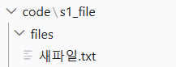
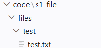
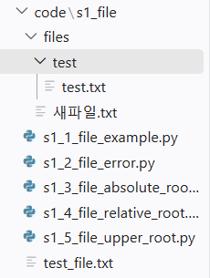
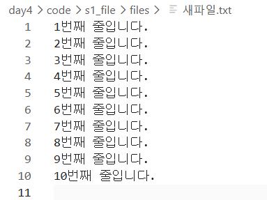
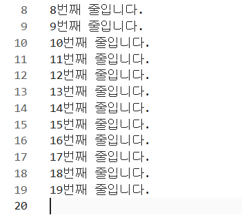
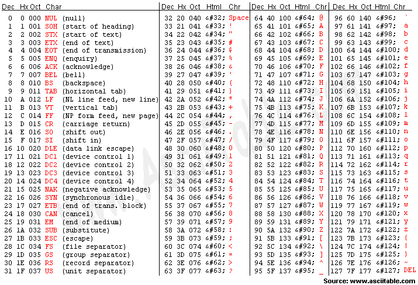

# 파일 읽고 쓰기

- *현 작업 환경에서는 ./day4/code/s1_file/files 경로를 생성하고 거기서 작업함*
    - 터미널 창에
        ```bash
        cd /day4/code/s1_file
        mkdir files
        cd files
        ```
        를 실행하면 해당 경로 생성 및 이동

## 파일 생성하기

- `파일_객체 = open(파일 이름, 파일_열기_모드)`
    - 파일을 생성하고 파일 객체를 반환

- 파일 함수 정의
```py
(function) def open(
    file: FileDescriptorOrPath,
    mode: OpenTextMode = "r",
    buffering: int = -1,
    encoding: str | None = None,
    errors: str | None = None,
    newline: str | None = None,
    closefd: bool = True,
    opener: _Opener | None = None
) -> TextIOWrapper[_WrappedBuffer]
```
- 파일 열기 모드

    

    - 쓰기모드
        - 쓰려는 파일이 없다면 새 파일 생성
        - 쓰려는 파일이 있다면 새 파일을 기존 파일에 덮어씀
```py
# 새파일.txt 파일 생성
f = open("새파일.txt", 'w')
f.close()
```

(파일이 생성된 모습)

- 만약 파일 경로가 유효하지 않으면 에러 발생
```py
# newfile2.py
f = open("C:/doit/새파일.txt", 'w') # 지금 컴퓨터엔 이 경로 없음
f.close()
```
```
Traceback (most recent call last):
  File "c:\Users\Admin\Desktop\workspace\python_basic\day4\code\s1_file\s1_2_file_error.py", line 2, in <module>
    f = open("C:/doit/새파일.txt", 'w')
        ~~~~^^^^^^^^^^^^^^^^^^^^^^^^^^^
FileNotFoundError: [Errno 2] No such file or directory: 'C:/doit/새파일.txt'
```
### 절대경로를 이용한 파일 생성
- 절대 경로: 파일 위치를 드라이브부터 현 위치까지 모두 표시한 경로
```py
f = open('C:/Users/Admin/Desktop/test.txt', 'w')
f.close()
```

- (바탕화면에 파일 생성)\

### 상대경로
- 상대 경로: 현재 위치를 기준으로 파일 경로를 찾음
- 경로 앞에 './'를 붙여줌
```py
f = open('./test/test.txt', 'w')
f.close()
```


### 상위 경로
- 현 파일 상위에 있는 경로
- '../'로 상위폴더라고 표기
```py
f = open('../test_file.txt', 'w')
f.close()
```


- 현 위치인 'files'의 상위 폴더인 's1_file' 경로에 파일이 생성됨

### 파일 경로와 슬래시
- 파이썬 코드에서 파일 경로 표시할 때 슬래시(/)로 구분
- 역슬래시로 표기하려면 기존 역슬래시(\\)를 두번 사용(이스케이프 문자로 표기)하거나(\\\\), 문자열 앞에 r을 붙여줌

## 파일을 쓰기 모드로 열어 내용 쓰기

- 파일 모드가 'w'이면 파일 내용을 쓸 수도 있음
- write함수
```py
(method) def write(
 s: str,
 /
) -> int
```
```
Write string s to stream.

Return the number of characters written (which is always equal to the length of the string).
```
- write 함수에 str 매개변수를 넘겨주면 파일에 그 str을 기록
```py
f = open('./새파일.txt', 'w')

for i in range(1, 11):
    data = f'{i}번째 줄입니다.\n'
    f.write(data)

f.close()
```


- 파일 한 줄에 '\n' 안쓰면 줄바꿈 없이 바로 이어짐

## 파일 읽기
- 파일을 읽으려면 open()함수에서 모드를 'r'로 설정
### readline()
- readline(): 파일의 한 줄을 읽어들이기
- 정의
```
(method) def readline(
 size: int = -1,
 /
) -> str

Read until newline or EOF.

Return an empty string if EOF is hit immediately. If size is specified, at most size characters will be read.
```
- 사용 예시
```py
f = open('./새파일.txt', 'r')

line = f.readline()
print(line)
f.close()
```
```
1번째 줄입니다.

```

- while문을 사용해서 파일 전체 읽어들이기

```py
# readline_all.py
f = open('./새파일.txt', 'r')
while True:
    line = f.readline()
    if not line: break # 라인 없으면 while문 종료
    print(line)
f.close()

```
```
1번째 줄입니다.

2번째 줄입니다.

3번째 줄입니다.

4번째 줄입니다.

5번째 줄입니다.

6번째 줄입니다.

7번째 줄입니다.

8번째 줄입니다.

9번째 줄입니다.

10번째 줄입니다.

```

### readlines()
- 함수의 파일의 모든 줄을 읽어서 각각의 줄을 요소로 가지는 리스트 반환
```py
f = open('./새파일.txt', 'r')
lines = f.readlines()

for line in lines:
    print(line)

print(lines)
f.close()
```
```
1번째 줄입니다.

2번째 줄입니다.

3번째 줄입니다.

4번째 줄입니다.

5번째 줄입니다.

6번째 줄입니다.

7번째 줄입니다.

8번째 줄입니다.

9번째 줄입니다.

10번째 줄입니다.

['1번째 줄입니다.\n', '2번째 줄입니다.\n', '3번째 줄입니다.\n', '4번째 줄입니다.\n', '5번째 줄입니다.\n', '6번째 줄입니다.\n', '7번째 줄입니다.\n', '8번째 줄입니다.\n', '9번째 줄입니다.\n', '10번째 줄입니다.\n']
```
#### 줄바꿈 문자 '\n' 제거하기
- strip 함수 사용
```
(method) def strip(
 chars: str | None = None,
 /
) -> str

Return a copy of the string with leading and trailing whitespace removed.

If chars is given and not None, remove characters in chars instead.
```
- 예시
```py
f = open('./새파일.txt', 'r')
lines = f.readlines()

for line in lines:
    line = line.strip() # 줄 끝의 줄바꿈 문자 제거
    print(line)

f.close()
```
```
1번째 줄입니다.
2번째 줄입니다.
3번째 줄입니다.
4번째 줄입니다.
5번째 줄입니다.
6번째 줄입니다.
7번째 줄입니다.
8번째 줄입니다.
9번째 줄입니다.
10번째 줄입니다.
```

### read
- read(): 파일 내용 전체를 문자열로 반환
```py
f = open('./새파일.txt', 'r')
data = f.read()

print(data)

f.close()
```
```
1번째 줄입니다.
2번째 줄입니다.
3번째 줄입니다.
4번째 줄입니다.
5번째 줄입니다.
6번째 줄입니다.
7번째 줄입니다.
8번째 줄입니다.
9번째 줄입니다.
10번째 줄입니다.
```

### 파일 객체를 for문과 함께 사용
- 파일 객체도 반복 가능한 객체
    - for문 사용 가능

```py
f = open('./새파일.txt', 'r')

for line in f:
    print(line)

f.close()
```
```
1번째 줄입니다.

2번째 줄입니다.

3번째 줄입니다.

4번째 줄입니다.

5번째 줄입니다.

6번째 줄입니다.

7번째 줄입니다.

8번째 줄입니다.

9번째 줄입니다.

10번째 줄입니다.

```

## 파일에 새로운 내용 추가하기
- 'a': 기존 파일에 새로운 내용 추가
    - 'w'는 기존 파일 내용을 모조리 지우고 새 내용만 기록해버림

```py
f = open('./새파일.txt', 'a')

for i in range(11, 20):
    data = f'{i}번째 줄입니다.\n'
    f.write(data)

f.close()
```

- 11번째\~19번째 줄 추가

## with문과 함께 사용
- `with open(filename, mode) as f:` 를 쓰면 파일 객체 `f=open()`과 `f.close()` 안써도 됨
    - with 블럭 내에서만 파일을 사용하고, 블럭을 벗어나는 순간 파일은 닫힘

```py
with open('foo.txt', 'w') as f:
    f.write('aaaaa')
```

## 파일 처리 시 주의 사항
- 한글이 포함된 파일 다룰 시 인코딩 명시하는게 좋음
- 명시 안하면 파일 깨질 수 있음
- open()함수에서 기본 인코딩은 utf-8

```py
with open('hangul.txt', 'w', encoding='utf-8') as f:
    f.write('ㅁㄴㅇㄿㅊ미ㅏ')

with open('hangul.txt', 'r') as f:
    data = f.read()

print(data)
```
```
ㅁㄴㅇㄿㅊ미ㅏ
```
### 인코딩과 UTF-8

컴퓨터는 문자를 직접 저장하지 못하고 숫자로 변환해서 저장한다. 이때 어떤 문자를 어떤 숫자로 변환할지 정하는 규칙이 인코딩(Encoding)이다. 예를 들어 'A'는 65, 'B'는 66으로 저장하는 식이다.

UTF-8은 현재 가장 널리 사용되는 인코딩 방식으로, 전 세계 모든 문자(한글, 영어, 중국어, 일본어, 이모지 등)를 표현할 수 있다. 파일을 저장하거나 읽을 때 UTF-8을 사용하면 어떤 컴퓨터에서든 한글이 깨지지 않고 올바르게 표시된다.

- 파이썬 3.15 이전에는 기본 인코딩으로 cp949를 사용했음
- 인코딩을 ascii를 사용한다면 한글은 지원 안함
    - 아스키코드 표

         (출처: 나무위키 아스키코드 표)