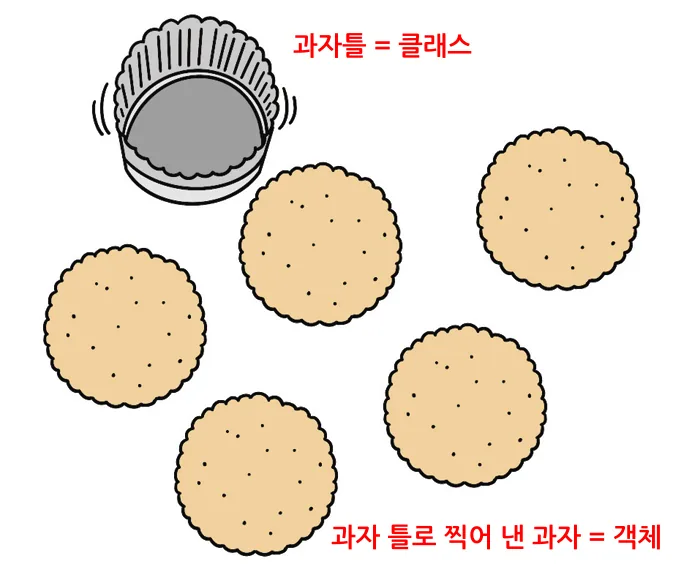

# 클래스

## 필요성
### 계산기로 보는 클래스의 필요성
```py
result1 = 0; result2 = 0

def add1(num):
    global result1
    result1 += num
    return result1

def add2(num):
    global result2
    result2 += num
    return result2


print(add1(3))
print(add1(4))

print(add2(3))
print(add2(7))
```
```
3
7
3
10
```
<video controls src="20261119-0215-22.7434989.mp4" title="Title"></video>
- 계산기1의 결과값이 계산기2의 결괏값에 영향 x
- 그러나 계산기가 많아지거나 기능을 추가하려면 복잡해짐
- -> 클래스 사용

```py
class Calc:
    def __init__(self):
        self.result = 0

    def add(self, num):
        self.result += num
        return self.result


calc1 = Calc()
calc2 = Calc()

print(calc1.add(3))
print(calc1.add(4))

print(calc2.add(3))
print(calc2.add(7))
```
```
3
7
3
10
```

<video controls src="20261119-0216-19.5575175.mp4" title="Title"></video>

- 이번엔 빼기 메소드 추가
```py
class Calc:
    def __init__(self):
        self.result = 0

    def add(self, num):
        self.result += num
        return self.result

    def sub(self, num):
        self.result -= num
        return self.result

calc1 = Calc()
calc2 = Calc()

print(calc1.add(3))
print(calc1.add(4))
print(calc1.sub(2))

print(calc2.add(3))
print(calc2.add(7))
print(calc2.sub(4))
```
```
3
7
5
3
10
6
```

- 위 예제에 생성된 calc1 객체와 calc2는 별도의 객체
    - 같은 클래스를 사용했다는건 동물로 비유하자면 종류는 같은데 다른 개체라고 생각하면 됨.

- 즉, 클래스는 한 물건의 설계도로 보면 됨.
## 클래스와 객체

#### 노트북으로 비유하자면...
- 클래스: 노트북 설계도
- 객체: 설계도대로 만들어진 노트북

---

- 클래스로 만든 객체는 고유한 성격을 가짐
    - 노트북으로 치면 같은 노트북 종류더라도 시리얼 넘버가 다름
    - 그리고 사용자마다 깔린 프로그램도 다름

#### 클래스 예시
```py
class Laptop:
    pass

a = Laptop()
b = Laptop()

print(a)
print(b)

print(a == b)
```
```
<__main__.Laptop object at 0x00000270D2F88980>
<__main__.Laptop object at 0x00000270D2F68690>
False
```
- 위 노트북과 비유한 예시와 마찬가지로 같은 클래스를 쓰는 변수라도 서로 다른 메모리에 저장됨
- 즉 두 객체 a와 b는 다른 객체임을 의미
    

### 객체와 인스턴스의 차이
- a = Cookie()를 예시로 들면...
    - a는 객체이고, a객체는 Cookie의 인스턴스
    - 즉 인스턴스는 특정 객체가 어떤 클래스의 객체인지를 관계 위주로 설명할 때 사용됨

## 클래스에 기능 추가하기
```py
class Laptop:
    def printLaptop(self):
        print('노트북 프린트')

a1 = Laptop()

a1.printLaptop()
```
```
노트북 프린트
```
#### 인스턴스 메서드 매개변수 self
- self매개변수에는 값을 직접 전달하지 않음
- self칸에는 인스턴스가 자동으로 배치됨

```py
class Laptop:
    def setData(self):
        pass


    def printLaptop(self):
        print(self, '노트북 프린트')


a1 = Laptop()
print(a1)
a1.printLaptop()
```
```
<__main__.Laptop object at 0x0000028281DE8980>
<__main__.Laptop object at 0x0000028281DE8980> 노트북 프린트
```
- self를 출력할 때 a1객체의 메모리 주소를 출력함

- 그러나 setdata() 메서드에 a라는 매개변수를 추가하고, `self.name=a`를 추가, 그리고 이 메서드를 인수와 함께 호출하면 `self.name`은 해당 인수를 값으로 가짐
- 그리고 `a1.name`을 출력하면 그 인수를 출력함
```py
class Laptop:
    def setData(self, a):
        self.name=a


    def printLaptop(self):
        print(self, '노트북 프린트')


a1 = Laptop()
a1.setData("4070")
print(a1.name)
```
```
4070
```

- 여러개의 매개변수 전달 가능
```py
class Laptop:
    def setdata(self, 
                width, height, price, color):
        #self.name = 'Vision 학습 작업용 노트북'
        self.w = width
        self.h = height
        self.p = price
        self.c = color


    def printLaptop(self):
        print(self.w, self.h, '노트북 프린트')


a1 = Laptop()
a1.setdata(40, 30, 200, 'Black')
print(a1.w, a1.h, a1.p, a1.c)
```
```
40 30 200 Black
```

- 클래스명으로 접근해서 메서드 사용 가능
```py
#...(클래스 정의 생략)...
# 클래스명으로 접근해서 메서드 사용
a3 = Laptop()
Laptop.setdata(a3, 40, 30, 150, 'black')
a3.printLaptop()
```

### \_\_init\_\_
- setdata의 이름을 __init__으로 바꾸면 굳이 생성자를 호출하지 않고 객체를 선언할 때 `객체이름 = 클래스(매개변수1, 매개변수2,...)`처럼 가능
    - 객체 생성 시점에 자동 호출. `객체명.__init__()`처럼 호출하지 않음
- __init__은 생성자

```py
class Laptop:
    def __init__(self, 
                width, height, price, color):
        self.name = 'Vision 학습 작업용 노트북'
        self.w = width
        self.h = height
        self.p = price
        self.c = color


    def printLaptop(self):
        print(self.w, self.h, '노트북 프린트')


a1 = Laptop(40, 30, 200, 'Black')
print(a1.name, a1.w, a1.h, a1.p, a1.c)
```
```
Vision 학습 작업용 노트북 40 30 200 Black
```

## 상속
- 상속: 기존 클래스에 새로운 기능 추가
```py
class ChildClass(ParentClass):
    pass
```

- 상속 예시
```py
# s2_10_method_self.py
class Laptop:
    def __init__(self, 
                width, height, price, color, gpu):
        self.name = 'Vision 학습 작업용 노트북'
        self.w = width
        self.h = height
        self.p = price
        self.c = color
        self.gpu = gpu
        self.available = ['3080', '3090',
                         '4070', '4080', '4090',
                         '5060', '5070', '5080', '5090']


    def printLaptop(self):
        print(self.w, self.h, '노트북 프린트')


    def gpucheck(self):
        if self.gpu in self.available:
            print(f'{self.gpu}: 실습 가능')

        else:
            print(f'{self.gpu}: 실습 불가능')
```
```py
# s2_11_inheritance.py
from s2_10_method_self import Laptop

class Desktop(Laptop):
    def power_on(self):
        print(f'{self}의 전원이 켜짐')


if __name__ == '__main__':
    a = Desktop(40, 30, 200, 'black', '5060')
    a.power_on()
```
```
<__main__.Desktop object at 0x0000028D45368AD0>의 전원이 켜짐
```

### 상속 사용 이유
- 기존 클래스를 변경하지 않고 기능을 추가하거나 기존 기능을 변경하려고 할 때 사용
- 클래스가 라이브러리 형태나 수정이 허용되지 않을 때

## 메서드 오버라이딩
- 메서드 오버라이딩: 기존 부모클래스에 있는 메서드를 자식 클래스에서 동일한 클래스로 재작성

    ```py
    class Laptop:
        def __init__(self, 
                    width, height, price, color, gpu):
            self.name = 'Vision 학습 작업용 노트북'
            self.w = width
            self.h = height
            self.p = price
            self.c = color
            self.gpu = gpu
            self.available = ['3080', '3090',
                            '4070', '4080', '4090',
                            '5060', '5070', '5080', '5090']


        def printLaptop(self):
            print(self.w, self.h, '노트북 프린트')


        def gpucheck(self):
            if self.gpu in self.available:
                print(f'{self.gpu}: 실습 가능')

            else:
                print(f'{self.gpu}: 실습 불가능')


    class Desktop(Laptop):
        def printLaptop(self):
            print(self.w, self.h, '데스크톱 프린트')
        
        def power_on(self):
            print(f'{self}의 전원이 켜짐')


    if __name__ == '__main__':
        # a는 Laptop 클래스를 상속받은 Desktop 클래스를 사용하는 객체
        a = Desktop(40, 30, 200, 'black', '5060')

        # a의 printLaptop()은 Desktop 클래스에서 재작성된 메서드
        a.printLaptop()


        # b는 Laptop 클래스를 사용하는 객체
        b = Laptop(40, 30, 200, 'white', '5070')

        # b의 printLaptop()은 Laptop 클래스에 있는 메서드
        b.printLaptop()
    ```


## 클래스 변수
- 클래스변수: 클래스 내부에 바로 작성한 변수


    ```py
    class Laptop:

        # 클래스 변수
        available = [
            '3080', '3090',
            '4070', '4080', '4090',
            '5060', '5070', '5080', '5090']

        
        def __init__(self, 
                    width, height, price, color, gpu):

            # 인스턴스 변수
            self.name = 'Vision 학습 작업용 노트북'
            self.w = width
            self.h = height
            self.p = price
            self.c = color
            self.gpu = gpu


        def printLaptop(self):
            print(self.w, self.h, '노트북 프린트')


        def gpucheck(self):
            if self.gpu in self.available:
                print(f'{self.gpu}: 실습 가능')

            else:
                print(f'{self.gpu}: 실습 불가능')

    a = Laptop(10, 20, 30, 'red', '5060')
    print(a.available)
    a.gpucheck()
    ```
    ```
    ['3080', '3090', '4070', '4080', '4090', '5060', '5070', '5080', '5090']
    5060: 실습 가능
    ```

- 클래스변수는 모든 인스턴스가 공유할 수 있음
    ```py
    #...(클래스 정의 생략)...
    a = Laptop(10, 20, 30, 'red', '5060')
    print(a.available)
    a.gpucheck()

    # b 객체 생성
    b = Laptop(20, 30, 40, 'blue', '4060')

    # a 객체를 이용해 클래스 변수 available에 요소 추가
    a.available.append('4060')

    # b에서 available을 이용한 메소드 호출해보기
    print(b.available)
    b.gpucheck()
    ```
    ```
    ['3080', '3090', '4070', '4080', '4090', '5060', '5070', '5080', '5090']
    5060: 실습 가능
    ['3080', '3090', '4070', '4080', '4090', '5060', '5070', '5080', '5090', '4060']
    4060: 실습 가능
    ```