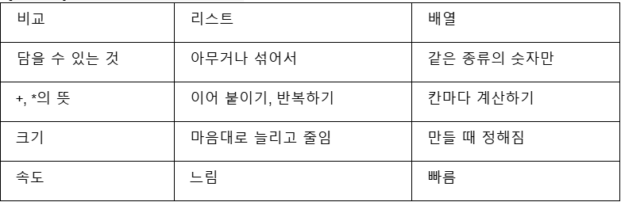
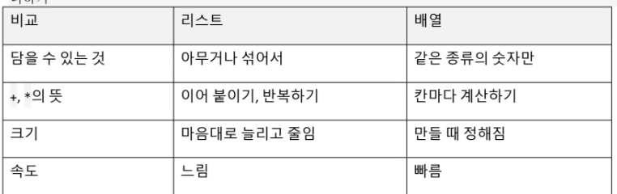
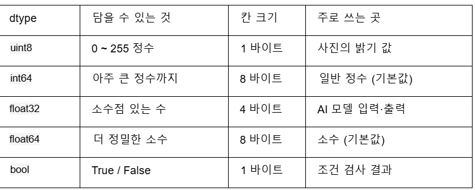

# numpy

## [numpy](https://numpy.org/)
- 파이썬의 리스트는 어떤 값이든 섞어 담을 수 있지만 숫자 수십만개 계산은 느림
- 속도가 빠른 넘파이와 판다스 사용
    - Numpy: 같은 종류의 숫자를 칸이 고정된 판(배열)에 담아서 모든 칸을 한 번에 계산
    - pandas: 배열에 행 이름과 열 이름을 붙인 표

- 카메라 영상과 AI모델이 내놓는 결과는 결국 숫자 덩어리

### 사용처
- Numpy: 사진/영상/프레임, AI모델 결과, 위치/거리 계산
- Pandas: 기록/로그, 비교/요약

### 다운로드
```bash
pip install numpy pandas matplotlib
```

- 잘 다운로드 되었는지 확인
    ```py
    import numpy as np
    import pandas as pd
    import matplotlib

    print(np.__version__)
    print(pd.__version__)
    print(matplotlib.__version__)
    ```
    ```
    2.5.5
    3.1.1
    3.11.2
    ```

## Numpy 기초
- Numpy중심: 배열(ndarray)
- ndarray는 모든 칸에 같은 종류의 자료형만 들어감
    - 대신 칸 전체를 한 번에 계산할 수 있음

### 리스트와 배열의 차이



    ```py
    import numpy as np

    # 리스트
    print('list')
    lst = [1, 2, 3]
    print(lst * 2)
    print(lst + [10, 20, 30])

    # 배열
    print('array')
    arr = np.array([1, 2, 3])
    print(arr * 2)
    print(arr + [10, 20, 30])
    ```
    ```
    list
    [1, 2, 3, 1, 2, 3]
    [1, 2, 3, 10, 20, 30]
    array
    [2 4 6]
    [11 22 33]
    ```
### 리스트와 배열의 차이
- 리스트는 곱하면 한 번 더 이어붙이고 더하면 서로 이어붙임
- 배열은 곱하면 칸마다 해당 수만큼 곱하고 더하면 같은 자리끼리 더함



- 배열은 한 종류만 들어가므로, 종류가 다른 값을 섞어 넣으면 모두를 담을 수 있는 쪽으로 맞춰짐

    ```py
    import numpy as np


    a = np.array([1, 2.5, 3])
    b = np.array([1, '2', 3])

    print(a, a.dtype)
    print(b, b.dtype)
    ```
    ```
    [1.  2.5 3. ] float64
    ['1' '2' '3'] <U21
    ```

### 얼마나 빠른가?
- 리스트는 반복문으로 하나씩 계산해야 하지만, Numpy 배열은 배열 전체를 한 번에 계산
- 리스트: $O(n)$
- 배열: $O(1)$
    ```py
    import time 
    import numpy as np 

    n = 1_000_000 # 100 만 (밑줄은 읽기 편하게 넣은 것, 숫자에 영향 없음) 
    lst = list(range(n)) 
    arr = np.arange(n) 
    t = time.perf_counter()


    r1 = [x ** 2 for x in lst] # 하나씩 제곱 
    t_list = time.perf_counter() - t 
    t = time.perf_counter() 


    r2 = arr ** 2 # 통째로 제곱 
    t_np = time.perf_counter() - t 


    print(f"리스트: {t_list:.4f}초") 
    print(f"NumPy : {t_np:.4f}초") 
    print(f"약 {t_list / t_np:.0f}배 차이") 

    ```
    ```
    리스트: 0.0401초
    NumPy : 0.0016초
    약 25배 차이
    ```

- 컴퓨터 성능마다 다르겠지만 배열이 확실히 빠름
- 영상의 경우 640x480 크기의 영상의 화소는 92만개 정도
- 리스트로 구현하단 너무 느림


### 배열 만들기
- 기본 배열: `np.array(리스트)`
- 영행렬: `np.zeros(행_개수, 열_개수)`
- 일행렬: `np.ones(행_개수, 열_개수)`
- 특정 값이 채워진 행렬: `np.full((행_개수, 열_개수), 채울_값)`
- 특정 수의 배수로 채워진 1차원 배열: `np.arange(시작값, 끝값, 범위)`
    - range()와 유사
- 시작값부터 끝값까지 정수개만큼 고르게 분포된 1차원 배열: `np.linspace(시작값, 끝값, 개수)`

    ```py
    import numpy as np 


    a = np.array([1, 2, 3]) # 한 줄짜리 
    b = np.array([[1, 2, 3], [4, 5, 6]]) # 2 줄 3 칸짜리 

    print(a) 
    print(b) 

    print(np.zeros((2, 3))) # 0 으로 채운 2 줄 3 칸

    print(np.ones((2, 3))) # 1 로 채운 2 줄 3 칸 

    print(np.full((2, 3), 7)) # 7 로 채운 2 줄 3 칸 

    print(np.arange(0, 10, 2)) # [0 2 4 6 8] 0 부터 2 씩, 10 직전까지 
    print(np.linspace(0, 1, 5)) # [0. 0.25 0.5 0.75 1. ] 0 과 1 사이를 5 개 값으로 고르게 
    ```
    ```
    [1 2 3]
    [[1 2 3]
    [4 5 6]]
    [[0. 0. 0.]
    [0. 0. 0.]]
    [[1. 1. 1.]
    [1. 1. 1.]]
    [[7 7 7]
    [7 7 7]]
    [0 2 4 6 8]
    [0.   0.25 0.5  0.75 1.  ]
    ```

#### 난수
- 난수는 numpy 내에 있는 random 모듈로 생성
    - seed: 생성기의 시작 번호
- default_rng(): 랜덤 시드 설정
- `integers(시작값, 끝값, 행렬_사이즈)`: 시작값과 끝값 사이 행렬 사이즈만큼 랜덤 행렬을 반환
- `random(행_개수, 열_개수)`: 행_개수, 열_개수 크기만큼의 0~1 사이 값을 가지는 랜덤 행렬 반환
- `normal(평균, 표준편차, size=배열_크기)`: 평균=평균, 표준편차=표준편차를 가지는 정규분포에 속한 배열_크기만큼의 크기를 가진 배열 반환

    ```py
    import numpy as np 


    rng = np.random.default_rng(seed=42) 

    print(rng.integers(0, 256, size=(2, 3))) # 0~255 사이 정수 (사진 밝기 범위) 
    print(rng.random((2, 3))) # 0~1 사이 실수 
    print(rng.normal(0, 1, size=5)) # 0 근처에 몰린 값 5 개 (센서 잡음을 흉내낼 때) 
    ```
    ```
    [[ 22 198 167]
    [112 110 219]]
    [[0.69736803 0.09417735 0.97562235]
    [0.7611397  0.78606431 0.12811363]]
    [-0.85304393  0.87939797  0.77779194  0.0660307   1.12724121]
    ```

### 배열의 속성
- shape: 크기 -> (행,열) 형태로 반환
- ndim: 방향이 몇 개인가(행의 개수)
    - '칸 하나의 위치를 말하려면 번호가 몇 개 필요한가?'
- size: 총 칸의 개수
- dtype: 칸에 든 숫자의 종류
    ```py
    import numpy as np 


    b = np.array([[1, 2, 3], [4, 5, 6]]) 

    print(b.shape) # (2, 3) ← 2 줄 3 칸 
    print(b.ndim) # 2 ← 방향이 몇 개인가 (줄, 칸 → 2 개) 
    print(b.size) # 6 ← 칸이 모두 몇 개인가 
    print(b.dtype) # int64 ← 칸에 든 숫자의 종류 
    ```
    ```
    (2, 3)
    2
    6
    int64
    ```

#### shape와 ndim 해석

차윈|shape 예|위치 말하는 방법|실제 예
---|---|---|---
1|(5,)|5번째|센서 값 5개
2|(480, 640)|480번째 줄 640번 칸|흑백 사진, 표
3|(480, 640, 3)|480번째 줄 640번째 칸의 빨강 값|컬러 사진
4|(8, 580, 640, 3)|8번째 사진의 480번째 칸의 640번 칸의 빨강 값|컬러사진 8장 묶음

### 배열 안에 든 숫자의 종류


- uint8: unsigned integer 8bit(1byte)
- int64: integer 64bit(8byte)
- float32: floating point 32bit(4byte)
- float64: floating point 64bit(8byte) (double)
- bool: 1byte(True/False)

- ndArray.astype(변경할_타입): 해당 타입으로 숫자 변경

    ```py
    import numpy as np 


    img = np.zeros((480, 640, 3), dtype=np.uint8) # 만들 때 종류를 정해주기 

    print(img.dtype, img.nbytes) # uint8 921600 ← 약 0.9MB 

    f = img.astype(np.float32) # 종류 바꾸기 (uint8 -> float32)

    print(f.dtype, f.nbytes) # float32 3686400 ← 4 배로 커짐 

    ```
    ```
    uint8 921600
    float32 3686400
    ```

- 같은 사진이라도 칸 종류에 크기가 4배차이까지 남
- 메모리 작은 소형 장치는 이 차이가 속도와 직결됨
