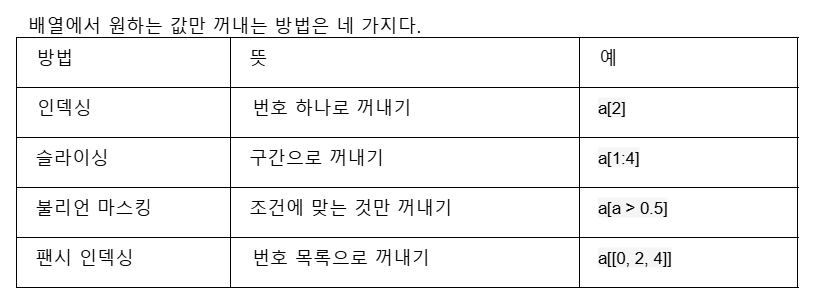
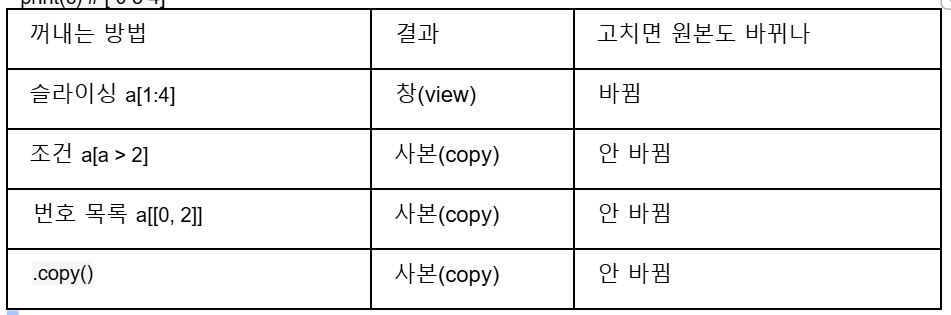

## 인덱싱/슬라이싱


### 1줄짜리 배열
- 리스트와 사용방법 동일
    ```py
    import numpy as np 

    a = np.array([10, 20, 30, 40, 50]) 
    # 번호: 0 1 2 3 4 

    print(a[0]) # 10 
    print(a[-1]) # 50 ← 맨 뒤 
    print(a[1:4]) # [20 30 40] ← 1 번부터 4 번 앞까지 
    print(a[:3]) # [10 20 30] ← 처음부터 3 번 앞까지 
    print(a[::2]) # [10 30 50] ← 한 칸씩 건너뛰며 
    print(a[::-1]) # [50 40 30 20 10] ← 거꾸로
    ```
    ```
    10
    50
    [20 30 40]
    [10 20 30]
    [10 30 50]
    [50 40 30 20 10]
    ```

### 여러줄 배열
- 2차원 배열은 [행_번호, 칸_번호]로 찾음
    ```py
    import numpy as np 

    b = np.arange(1, 13).reshape(3, 4) # 1~12 를 3 줄 4 칸으로 
    print(b) 


    # 칸 0 1 2 3 
    # 줄 0 [[ 1 2 3 4] 
    # 줄 1 [ 5 6 7 8] 
    # 줄 2 [ 9 10 11 12]] 
    print(b[1, 2]) # 7 ← 1 번 줄, 2 번 칸
    print(b[0]) # [1 2 3 4] ← 0 번 줄 통째로 
    print(b[:, 1]) # [ 2 6 10] ← 모든 줄의 1 번 칸 (세로 한 줄) 
    print(b[0:2, 1:3]) # 0~1 번 줄, 1~2 번 칸으로 된 네모 영역 
    # [[2 3] 
    # [6 7]] 
    ```
    ```
    [[ 1  2  3  4]
    [ 5  6  7  8]
    [ 9 10 11 12]]
    7
    [1 2 3 4]
    [ 2  6 10]
    [[2 3]
    [6 7]]
    ```

#### reshape(행, 열)
- 원래 배열을 다른 크기로 변경
    ```py
    import numpy as np 


    b = np.arange(1, 13).reshape(3, 4) # 1~12 를 3 줄 4 칸으로 
    print(b) 


    # 칸 0 1 2 3 

    # 줄 0 [[ 1 2 3 4] 
    # 줄 1 [ 5 6 7 8] 
    # 줄 2 [ 9 10 11 12]] 

    print(b[1, 2]) # 7 ← 1 번 줄, 2 번 칸
    print(b[0]) # [1 2 3 4] ← 0 번 줄 통째로 
    print(b[:, 1]) # [ 2 6 10] ← 모든 줄의 1 번 칸 (세로 한 줄) 
    print(b[0:2, 1:3]) # 0~1 번 줄, 1~2 번 칸으로 된 네모 영역 
    # [[2 3] 
    # [6 7]] 
    ```
    ```
    [[ 1  2  3  4]
    [ 5  6  7  8]
    [ 9 10 11 12]]
    7
    [1 2 3 4]
    [ 2  6 10]
    [[2 3]
    [6 7]]
    ```

#### 인덱싱과 슬라이싱으로 값 넣기
- 영역을 지정하고 한 번에 채움
    ```py
    import numpy as np 

    c = np.zeros((4, 4), dtype=int) 

    c[1:3, 1:3] = 9 # 가운데 2×2 영역을 9 로 채우기 
    c[0, :] = 1 # 맨 윗줄을 1 로 
    print(c) 
    # [[1 1 1 1] 
    # [0 9 9 0] 
    # [0 9 9 0] 
    # [0 0 0 0]] 
    ```
    ```
    [[1 1 1 1]
    [0 9 9 0]
    [0 9 9 0]
    [0 0 0 0]]
    ```

### 불리언 마스킹
- 특정 칸마다 True/False 판정 붙이고, 그 판정표를 배열에 대면 통과한 값만 남음
    ```py
    import numpy as np 

    conf = np.array([0.91, 0.32, 0.77, 0.15, 0.58]) # AI 가 낸 신뢰도 

    mask = conf >= 0.5 # ① 판정표 만들기 


    print(mask) # [ True False True False True] 
    print(conf[mask]) # ② 통과한 것만: [0.91 0.77 0.58] 
    print(mask.sum()) # 3 ← True 는 1 로 세어지므로 '통과한 개수'가 된다
    ```
    ```
    [ True False  True False  True]
    [0.91 0.77 0.58]
    3
    ```
- 조건 붙일 때 and, or ,not 대신 &, |, ~ 사용
    ```py
    import numpy as np 

    conf = np.array([0.91, 0.32, 0.77, 0.15, 0.58]) 

    print(conf[
        (conf > 0.3) & (conf < 0.8)
        ]) # [0.32 0.77 0.58] 0.3 보다 크고 그리고 0.8 보다 작은 

    print(conf[
        (conf < 0.2) | (conf > 0.9)
        ]) # [0.91 0.15] 0.2 보다 작거나 또는 0.9 보다 큰 

    print(conf[
        ~(conf > 0.5)
        ]) # [0.32 0.15] 0.5 보다 크지 않은
    ```
    ```
    [0.32 0.77 0.58]
    [0.91 0.15]
    [0.32 0.15]
    ```
- 불리언 마스킹은 OpenCV의 이미지 마스킹 등에 쓰임
- 아래 코드는 이미지 이진화(흰색/검은색으로 나누는 작업)을 넘파이로 나타낸 것
    ```py
    import numpy as np 

    rng = np.random.default_rng(0) 

    gray = rng.integers(0, 256, size=(4, 4)) # 밝기 0~255 인 작은 사진 print(gray) 

    # 원본을 해치지 않기 위해 카피
    binary = gray.copy() 


    # 128보다 크면 흰색, 아니면 검은색
    binary[gray >= 128] = 255 # 밝은 칸 → 흰색 
    binary[gray < 128] = 0 # 어두운 칸 → 검은색 
    print(binary) 


    # 한 줄 버전: np.where(조건, 맞으면 이 값, 틀리면 이 값) 
    binary2 = np.where(gray >= 128, 255, 0) 
    print((binary == binary2).all()) # True ← 두 방법의 결과가 같다 
    ```
    ```
    [[255 255 255   0]
    [  0   0   0   0]
    [  0 255 255 255]
    [255 255 255 255]]
    True
    ```

### 팬시 인덱싱
- 꺼낼 번호들을 리스트로 감싸서 그 번호의 값을 적힌 순서대로 가져옴
    ```py
    import numpy as np 


    a = np.array([10, 20, 30, 40, 50]) 
    print(a[[0, 2, 4]]) # [10 30 50] 
    print(a[[4, 0]]) # [50 10] ← 순서도 목록대로 

    b = np.arange(1, 13).reshape(3, 4) 
    print(b[[0, 2]]) # 0 번 줄과 2 번 줄 
    ```
    ```
    [10 30 50]
    [50 10]
    [[ 1  2  3  4]
    [ 9 10 11 12]]
    ```
- argsort와 같이 사용한 예제
    - argsort(): 작은 것부터 줄 세우면 몇 번, 몇 번, 몇 번 순서인지 번호 순서대로 돌려줌
```py
import numpy as np 


conf = np.array([0.91, 0.32, 0.77]) 
names = np.array(["person", "car", "dog"]) 


order = np.argsort(conf)[::-1] # 큰 것부터의 번호 순서 

print(order) # [0 2 1] 
print(conf[order]) # [0.91 0.77 0.32] 
print(names[order]) # ['person' 'dog' 'car'] ← 이름도 같은 순서로
```
```
[0 2 1]
[0.91 0.77 0.32]
['person' 'dog' 'car']
```

### view와 copy
- view: 원래 배열의 일부를 들여다봄
    - view로 보이는 값을 고치면 원래 배열이 바뀜
- copy: 원본과 같은 값을 복사
    - copy로 생성한 변수는 원래 변수와 다른 변수(메모리 저장 위치 다름)
    - 원본 지켜야 할 때 copy 사용
    ```py
    import numpy as np 

    a = np.array([1, 2, 3, 4, 5]) 


    v = a[1:4] # 창(view) 
    v[0] = 99 
    print(a) # [ 1 99 3 4 5] ← 원본이 바뀜! 


    c = a[1:4].copy() # 사본(copy) 
    c[0] = 0 
    print(a) # [ 1 99 3 4 5] ← 원본은 그대로 
    print(c) # [ 0 3 4] 
    ```
    ```
    [ 1 99  3  4  5]
    [ 1 99  3  4  5]
    [0 3 4]
    ```

