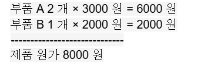
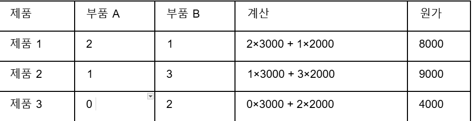
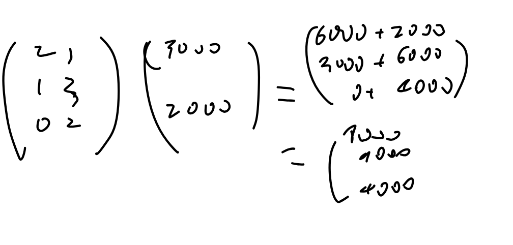
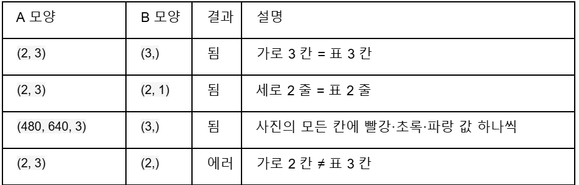

# 배열 계산과 브로드캐스팅
## 같은 자리끼리 계산
- 브로드캐스팅: 같은 자리끼리 계산
    ```py
    import numpy as np 


    a = np.array([1, 2, 3, 4]) 
    b = np.array([10, 20, 30, 40]) 

    print(a + b) # [11 22 33 44] ← 1+10, 2+20, 3+30, 4+40 
    print(b - a) # [ 9 18 27 36] 
    print(a * b) # [ 10 40 90 160] ← 1×10, 2×20, ...
    print(b / a) # [10. 10. 10. 10.] ← 나눗셈 결과는 항상 소수 
    print(b // 3) # [ 3 6 10 13] ← 몫 
    print(a % 2) # [1 0 1 0] ← 나머지 (홀수면 1) 
    print(a ** 2) # [ 1 4 9 16] ← 제곱 
    ```
    ```
    [11 22 33 44]
    [ 9 18 27 36]
    [ 10  40  90 160]
    [10. 10. 10. 10.]
    [ 3  6 10 13]
    [1 0 1 0]
    [ 1  4  9 16]
    ```
### 행렬곱(@): 모두 더해서 곱합
- *는 같은 자리끼리 곱함. 그러나 아래 예시에서\
\
A가 [2, 1]같은 경우는>?

    ```py
    import numpy as np 

    qty = np.array([2, 1]) # 부품 수량: A 2 개, B 1 개 
    price = np.array([3000, 2000]) # 부품 단가: A 3000 원, B 2000 원 
    print(qty * price) # [6000 2000] ← 곱하기만 함 (부품별 금액) 
    print((qty * price).sum()) # 8000 ← 곱하고 더하기 
    print(qty @ price) # 8000 ← 위와 같은 계산을 한 번에

    ```
    ```
    [6000 2000]
    8000
    8000
    ```

- 제품이 여러 종류면...\


```py
import numpy as np 


qty = np.array([
    [2, 1], # 제품 1 
    [1, 3], # 제품 2 
    [0, 2]]) # 제품 3
 
price = np.array([3000, 2000]) 

print(qty @ price) # [8000 9000 4000] ← 제품별 원가 

```
```
[8000 9000 4000]
```


- 비전에서의 행렬곱: $red \times 0.299 + green \times 0.587 + blue \times 0.114=$
$$\begin{bmatrix}red\\green\\blue\\\end{bmatrix} \times \begin{bmatrix}0.299 & 0.587 & 0.114\end{bmatrix}$$

### 더 알아보기: 점을 돌리고 올리기
- 카메라가 본 물체 위치를 로봇 기준 위치로 바꿀 때도 @를 쓴다. 
    - 카메라와 로봇은 각자 자기 위치를 기준(0, 0)으로 위치를 말한다.
    - 마주 보고 선 사람에게 "내 오른쪽"은 상대방에게 왼쪽인 것처럼, 기준이 다르면 같은 위치도 다르게 표현된다. 
    - 그래서 방향을 돌리고(회전), 떨어진 만큼 옮겨야(이동) 한다. 
    ```py
    import numpy as np 

    R = np.array([
        [0, -1], 
        [1, 0]]) # 90 도 회전용 숫자표 

    t = np.array([0.5, 0.0]) # 카메라가 로봇에서 떨어진 거리 (m) 

    obj_cam = np.array([
        [0.10, 0.05], 
        [0.30, -0.02]]) # 카메라가 본 물체 2 개의 위치 (m) 


    obj_robot = obj_cam @ R.T + t # ① 돌리고(@) ② 옮기기(+) 

    print(obj_robot) 
    # [[0.45 0.1 ] 
    # [0.52 0.3 ]] ← 로봇 기준 위치 

    ```
    ```
    [[0.45 0.1 ]
    [0.52 0.3 ]]
    ```
- R.T: 행렬 R의 전치행렬

## 비교하기
- 비교 결과: True, False

    ```py
    import numpy as np 

    temp = np.array([36.5, 37.2, 38.1, 36.9]) # 측정 온도 4 개 

    # 37.5보다 큰가?
    print(temp > 37.5) # [False False True False] 

    # 하나라도 37.5보다 큰가?
    print((temp > 37.5).any()) # True 

    # 전부 40도 미만인가?
    print((temp < 40).all()) # True

    if (temp > 37.5).any(): # if 에는 True/False 하나만 들어갈 수 있다  
        print("기준 초과 값 있음") 
    ```
    ```
    [False False  True False]
    True
    True
    기준 초과 값 있음
    ```

### 컴퓨터와 소수
- 소수는 컴퓨터 안에서 아주 조금씩 오차 발생
    - == 쓰면 가끔 False가 뜰 수 있음
    - np.isclose() 사용
    ```py
    import numpy as np

    print(0.1 + 0.2)
    print(0.3)
    print(0.1 + 0.2 == 0.3)
    print(np.isclose(0.1+0.2, 0.3))
    ```
    ```
    0.30000000000000004
    0.3
    False
    True
    ```

## 모든 칸에 같은 함수 적용하기
- np.sqrt(제곱근), np.abs(절댓값)같은 Numpy()함수는 배열의 모든 칸에 한 번 적용
    - python의 math 라이브러리에 있는 함수는 하나의 값만 처리할 수 있음

    ```py
    import numpy as np 


    x = np.array([-4.7, -1.2, 0.0, 2.5, 9.0]) 

    print(np.abs(x)) # [4.7 1.2 0. 2.5 9. ] ← 부호 떼기 
    print(np.round(x)) # [-5. -1. 0. 2. 9.] ← 반올림 (.5 는 짝수 쪽으로) 
    print(np.floor(x)) # [-5. -2. 0. 2. 9.] ← 내림 
    print(np.ceil(x)) # [-4. -1. 0. 3. 9.] ← 올림 
    print(np.clip(x, 0, 5)) # [0. 0. 0. 2.5 5. ] ← 0 보다 작으면 0, 5 보다 크면 5 로
    ```
    ```
    [4.7 1.2 0.  2.5 9. ]
    [-5. -1.  0.  2.  9.]
    [-5. -2.  0.  2.  9.]
    [-4. -1.  0.  3.  9.]
    [0.  0.  0.  2.5 5. ]
    ```

### 두 점의 거리 구하기
- np.linalg.norm() 사용
    - 유클리드 노름 계산
    $$norm(p1, p2) = \sqrt{(p1_x - p2_x)^2 + (p1_y-p2_y)^2}$$

```py
import numpy as np 

p1 = np.array([100, 200]) 
p2 = np.array([400, 600]) 
print(np.linalg.norm(p2 - p1)) # 500.0 ← 두 점 사이 직선 거리 
```
```
500.0
```

## 브로드캐스팅
- 배열에 숫자 하나를 더하면 모든 칸에 더해지는 현상
    ```py
    import numpy as np 

    a = np.array([1, 2, 3]) 
    print(a + 10) # [11 12 13]
    ```
    ```
    [11 12 13]
    ```
- 행이 2개 이상이면 행에 따라, 열에 따라 적용됨
    ```py
    import numpy as np

    M = np.array([
        [1, 2, 3], 
        [4, 5, 6]]) # 2 줄 3 칸 


    row = np.array([10, 20, 30]) # 가로 한 줄 → 모든 줄에 적용 
    print(M + row) 
    # [[11 22 33] 
    # [14 25 36]] 


    col = np.array([
        [100], 
        [200]]) # 세로 한 줄 → 모든 칸에 적용 

    print(M + col) 
    # [[101 102 103] 
    ```
    ```
    [[11 22 33]
    [14 25 36]]
    [[101 102 103]
    [204 205 206]]
    ```

- 브로드캐스팅 규칙\


### 브로드캐스팅 예시
```py
import numpy as np 

points = np.array([[100, 200], [300, 400], [50, 60]]) # 찾은 물체 3 개의 중심 
center = np.array([320, 240]) # 화면 가운데 
dist = np.linalg.norm(points - center, axis=1) # 각 점에서 가운데까지 거리 

print(dist.round(1)) # [223.6 161.2 324.5] 
print(points[np.argmin(dist)]) # [300 400] ← 가운데에 가장 가까운 물체 
```