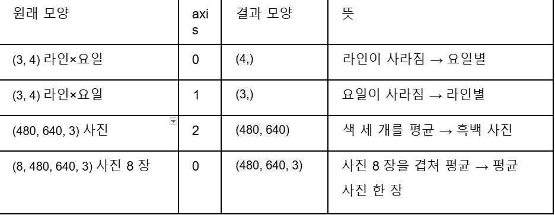

# 집계와 axis

## 기본 요약 함수
```py
import numpy as np 

x = np.array([3, 7, 1, 9, 4]) 
print(x.sum()) # 24 합계 
print(x.mean()) # 4.8 평균 
print(x.min()) # 1 가장 작은 값
print(x.max()) # 9 가장 큰 값 
print(x.argmin()) # 2 가장 작은 값이 있는 자리(번호) 
print(x.argmax()) # 3 가장 큰 값이 있는 자리(번호) 
print(np.median(x)) # 4.0 줄 세웠을 때 가운데 값 
print(x.std().round(2)) # 2.86 표준편차: 값들이 평균에서 평균적으로 얼마나 떨어져 있는지 
```
```
24
4.8
1
9
2
3
4.0
2.86
```

## axis
- axis=0: 행 기준
- axis=1: 열 기준

    ```py
    import numpy as np 

    prod = np.array([
        [80, 90, 70, 60], 
        [95, 85, 75, 65], 
        [70, 60, 90, 80]]) # 라인 3 개 × 요일 4 일

    print(prod.mean().round(1)) # 76.7 ← 방향 없이 전체 평균 
    print(prod.mean(axis=0).round(1)) # [81.7 78.3 78.3 68.3] ← 요일별 평균 (4 개) 
    print(prod.mean(axis=1)) # [75. 80. 75.] ← 라인별 평균 (3 개) 
    ```
    ```
    76.7
    [81.7 78.3 78.3 68.3]
    [75. 80. 75.]
    ```
- axis 예시\


## 정규화
- 단위와 크기가 제각각인 값을 그대로 비교하면 숫자가 큰 거리만 눈에 띔
    - 정규화: 만점이 다른 시험 점수를 100점 만점으로 환산하는 것과 같음

- MinMaxNormalization: 
$$MinMax(x) = \frac{x_i-min(x)}{max(x)-min(x)}$$

```py
import numpy as np 


# 열: 온도(℃), 습도(%), 거리(mm) 
sensor = np.array(
    [[22.1, 45.0, 1200], 
    [23.5, 50.2, 800], 
    [21.8, 48.7, 1500], 
    [24.0, 52.1, 950]]) 

mn = sensor.min(axis=0) # 열마다 최솟값 (3 개) 
mx = sensor.max(axis=0) # 열마다 최댓값 (3 개) 

norm = (sensor - mn) / (mx - mn) 

print(mn) # [ 21.8 45. 800. ]
print(mx) # [ 24. 52.1 1500. ] 
print(norm.round(2)) # 모든 값이 0~1 사이로 바뀜 
```

```
[ 21.8  45.  800. ]
[  24.    52.1 1500. ]
[[0.14 0.   0.57]
[0.77 0.73 0.  ]
[0.   0.52 1.  ]
[1.   1.   0.21]]
```

## NaN
- Nan(Not a Number): 빈 값
- 연산의 결과가 유효하지 않거나 정의되지 않을 때 발생하는 특수 값
- 자료형에 NaN이 하나라도 있으면 일반함수의 값도 NaN이 됨
- NaN은 == 연산으로 확인 불가능 -> NaN == Nan = False
    - isnan() 함수 사용

```py
import numpy as np 

d = np.array([1.2, np.nan, 3.4, 2.0]) 

print(d.mean()) # nan ← 빈 값 때문에 계산 불가 
print(np.nanmean(d)) # 2.2 ← 빈 값을 빼고 평균 
print(np.isnan(d)) # [False True False False] ← 어느 칸이 비었나 
print(d[~np.isnan(d)]) # [1.2 3.4 2. ] ← 빈 칸 빼고 남기기 
print(np.nan == np.nan) # False ← NaN 은 == 로 확인할 수 없다
```
```
nan
2.1999999999999997
[False  True False False]
[1.2 3.4 2. ]
False
```

# 모양 바꾸기와 합치기
## reshape
- ndarray.reshape(행, 열): ndarray 배열을 (행, 열) 모양의 배열로 변경
- 행, 열 중 하나를 -1로 하고 나머지를 원하는 값으로 변경하면 -1로 지정한 부분은 저절로 맞춰짐
    - 단 개수가 안맞으면 에러 발생
    ```py
    import numpy as np 

    a = np.arange(12) # [ 0 1 2 ... 11] 한 줄에 12 개 print(a) 

    print(a.reshape(3, 4)) # 3 줄 4 칸 
    print(a.reshape(2, 6)) # 2 줄 6 칸 
    print(a.reshape(-1, 6).shape) # (2, 6) ← -1 은 "나머지는 알아서 맞춰줘" print(a.reshape(-1, 1).shape) # (12, 1) ← 세로로 길게 한 줄

    try: 
        a.reshape(5, 2) 
    except ValueError as e: 
        print("에러:", e) # 12 개를 10 칸에 못 담음 

    ```
    ```
    [[ 0  1  2  3]
    [ 4  5  6  7]
    [ 8  9 10 11]]
    [[ 0  1  2  3  4  5]
    [ 6  7  8  9 10 11]]
    (2, 6)
    에러: cannot reshape array of size 12 into shape (5,2)
    ```

### ravel()
- ravel(): 다시 한 줄로 펴기
    ```py
    import numpy as np 

    b = np.arange(6).reshape(2, 3) 
    print(b) 
    print(b.ravel()) # [0 1 2 3 4 5] 
    ```
    ```
    [[0 1 2]
    [3 4 5]]
    [0 1 2 3 4 5]
    ```

## transpose
- 2darray.T: 행렬의 행과 열을 바꿔줌
- reshape와 차이점
    - reshape: 순서대로 옮겨담기만 함
    - transpose: 표를 돌려서 줄과 칸을 바꿈
        ```py
        import numpy as np 
        x = np.array([
            [1, 2, 3], 
            [4, 5, 6]]) # 2 줄 3 칸 

        print(x.T) # 3 줄 2 칸 
        # [[1 4] 
        # [2 5] 
        # [3 6]] 

        print(x.reshape(3, 2)) # reshape 와 비교 
        # [[1 2] 
        # [3 4] 
        # [5 6]] 
        ```
        ```
        [[1 4]
        [2 5]
        [3 6]]
        [[1 2]
        [3 4]
        [5 6]]
        ```
## 벡터 방향추가/제거
- AI모델은 사진 여러장 묶어서(배치 단위로) 받도록 만들어짐
- 1장짜리 묶음의 경우 방향 덧씌우고 결과 나오면 다시 벗겨야함
- 기존 배열에 np.newaxis 차원 추가
    - `차원_추가_이미지 = 기존_이미지[np.newaxis]`
- 차원 다시 없애기
    - `되돌릴_이미지 = 차원_추가_이미지.squeeze()`
    ```py
    import numpy as np 

    img = np.zeros((3, 480, 640)) 

    batch = img[np.newaxis] # 맨 앞에 크기 1 인 방향 추가 
    print(batch.shape) # (1, 3, 480, 640) 

    out = np.zeros((1, 5, 6)) # 모델 결과도 1 장짜리 묶음에 담겨 나옴 
    print(out[0].shape) # (5, 6) ← 0 번째 꺼내기 

    print(out.squeeze().shape) # (5, 6) ← 크기 1 인 방향을 모두 없애기
    ```
    ```
    (1, 3, 480, 640)
    (5, 6)
    (5, 6)
    ```
### 가로/세로로 늘어뜨리기
- 세로: 1darray[:, np.newaxis]
- 가로: 1darray[np.newaxis, :]
```py
import numpy as np 
v = np.array([1, 2, 3]) 
print(v.shape) # (3,) 
print(v[:, np.newaxis].shape) # (3, 1) ← 세로로 세움 
print(v[np.newaxis, :].shape) # (1, 3) ← 가로 한 줄짜리 표 
```
```
(3,)
(3, 1)
(1, 3)
```

## 합치기: concatenate와 stack
- concatenate: 길게 이어붙이기
    - axis=0: 아래로 붙이기
    - axis=1: 오른쪽에 붙이기
- stack: 위로 쌓기

    ```py
    import numpy as np 

    a = np.array([[1, 2], [3, 4]]) # 2 줄 2 칸 
    b = np.array([[5, 6], [7, 8]]) # 2 줄 2 칸 

    print(np.concatenate([a, b], axis=0).shape) # (4, 2) ← 아래로 이어 붙임 
    print(np.concatenate([a, b], axis=1).shape) # (2, 4) ← 옆으로 이어 붙임 
    print(np.stack([a, b]).shape) # (2, 2, 2) ← 두 장을 쌓음 

    print(np.concatenate([a, b], axis=0))
    print(np.concatenate([a, b], axis=0))
    ```
    ```
    (4, 2)
    (2, 4)
    (2, 2, 2)
    [[1 2]
    [3 4]
    [5 6]
    [7 8]]
    [[1 2 5 6]
    [3 4 7 8]]
    ```

- stack는 항상 위로 쌓음
- 쌓을 때마다 차원 증가
    ```py
    import numpy as np 

    frames = [] 
    for i in range(5): 
        frame = np.full((4, 4), i) # 사진 한 장을 얻었다고 가정 
        frames.append(frame) # 리스트에 담아 두기 

    video = np.stack(frames) # 마지막에 한 번 쌓기 
    print(video.shape) # (5, 4, 4) 
    print(video)
    ```
    ```
    5, 4, 4)
    [[[0 0 0 0]
    [0 0 0 0]
    [0 0 0 0]
    [0 0 0 0]]

    [[1 1 1 1]
    [1 1 1 1]
    [1 1 1 1]
    [1 1 1 1]]

    [[2 2 2 2]
    [2 2 2 2]
    [2 2 2 2]
    [2 2 2 2]]

    [[3 3 3 3]
    [3 3 3 3]
    [3 3 3 3]
    [3 3 3 3]]

    [[4 4 4 4]
    [4 4 4 4]
    [4 4 4 4]
    [4 4 4 4]]]
    ```