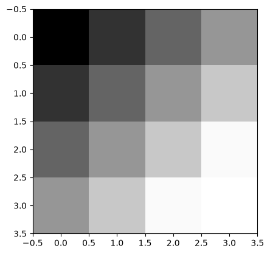
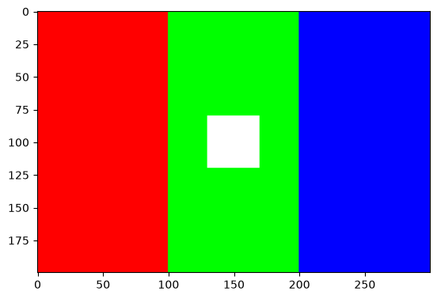
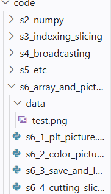
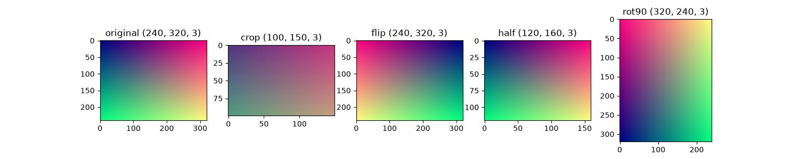
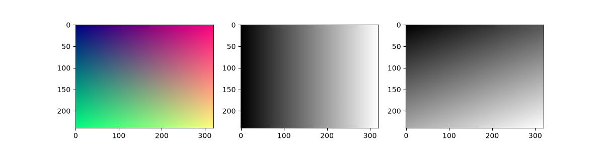
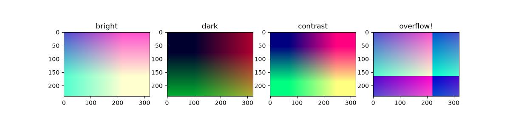
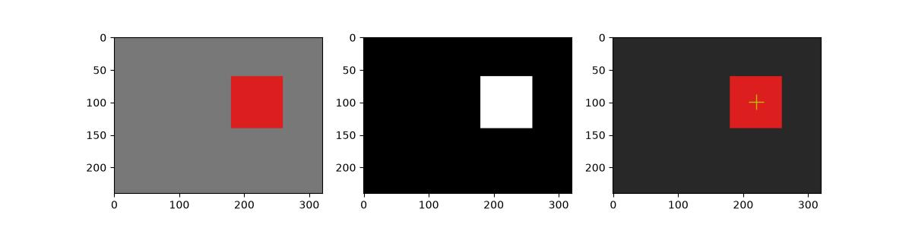

# 사진을 배열로 다루기
## 사진의 구조
- 흑백사진 구조
```py
import numpy as np 
import matplotlib.pyplot as plt 

gray = np.array([
    [ 0, 50, 100, 150],
    [ 50, 100, 150, 200], 
    [100, 150, 200, 250], 
    [150, 200, 250, 255]], 
    dtype=np.uint8
) 

print(gray.shape, gray.dtype) # (4, 4) uint8 
print(gray[0, 0], gray[3, 3]) # 0 255 ← 왼쪽 위가 가장 어둡고 오른쪽 아래가 가장 밝다 

plt.imshow(gray, cmap="gray", vmin=0, vmax=255) # 숫자를 밝기로 그려서 보여주기 plt.colorbar() # 오른쪽에 숫자-밝기 대응표 plt.show() 
plt.show()
```


- 컬러 영상은 3차원 배열
    - R-G-B를 다루는 영역이 따로 있음

    ```py
    import numpy as np 
    import matplotlib.pyplot as plt


    # 가로 300, 세로 200인 사진
    H, W = 200, 300 
    img = np.zeros((H, W, 3), dtype=np.uint8) # 검은 바탕 (모두 0) 


    img[:, :100] = [255, 0, 0] # 왼쪽 영역 → 빨강 
    img[:, 100:200] = [0, 255, 0] # 가운데 → 초록 
    img[:, 200:] = [0, 0, 255] # 오른쪽 → 파랑 

    img[80:120, 130:170] = 255 # 가운데 작은 네모 → 흰색 (세 값 모두 255) 

    print(img.shape) # (200, 300, 3) 
    print(img[100, 50]) # [255 0 0] ← y=100, x=50 픽셀은 빨강 
    print(img[100, 150]) # [255 255 255] ← 가운데 네모는 흰색 
    plt.imshow(img) 
    plt.show() 
    ```
    ```
    (200, 300, 3)
    [255   0   0]
    [255 255 255]
    ```


## 파일 저장하고 다시 불러오기
- os.makedirs(): 경로 생성
    - exsit_ok: 중복 허용 여부
- plt.imsave(경로, 저장할 사진): 저장할 사진을 경로에 저장
    ```py
    import os 
    import numpy as np 
    import matplotlib.pyplot as plt 

    os.makedirs("data", exist_ok=True) 

    img = np.zeros((100, 150, 3), dtype=np.uint8) 
    img[:, :75] = [255, 128, 0] # 왼쪽 절반 주황 

    plt.imsave("data/test.png", img) # 배열 → 사진 파일 
    loaded = plt.imread("data/test.png") # 사진 파일 → 배열 

    print(loaded.shape, loaded.dtype) # (100, 150, 4) float32 
    print(loaded[0, 0]) # [1. 0.5 0. 1. ] 근처 값
    ```



- 필자의 경우 ./day5/code/s6/array_and_picture 경로에 해당 코드를 실행함

### jpg와 png
- png: 0~1 사이의 소수로 읽음
- jpg: 0~255 사이의 정수값으로 구성

    ```py
    import os 
    import numpy as np 
    import matplotlib.pyplot as plt 


    os.makedirs("data", exist_ok=True) 
    plt.imsave("data/test.png", np.full((100, 150, 3), 200, dtype=np.uint8)) 


    img = plt.imread("data/test.png") 
    print("읽은 직후:", img.shape, img.dtype) # (100, 150, 4) float32 


    if img.dtype != np.uint8: # 0~1 소수라면 
        img = (img * 255).round().astype(np.uint8) # 0~255 정수로 

    img = img[:, :, :3] # 투명도가 있으면 빼고 색 3 개만 
    print("맞춘 뒤:", img.shape, img.dtype) # (100, 150, 3) uint8 
    print(img[0, 0]) # [200 200 200] 
    ```
    ```
    읽은 직후: (100, 150, 4) float32
    맞춘 뒤: (100, 150, 3) uint8
    [200 200 200]
    ```
    


## 자르기와 뒤집기
- 슬라이싱으로 자르거나 뒤집기 가능
    ```py
    import numpy as np 
    import matplotlib.pyplot as plt 

    # 그라데이션 사진 만들기 (브로드캐스팅 활용) 
    H, W = 240, 320 
    y = np.linspace(0, 1, H)[:, np.newaxis] # 위→아래로 0→1 (세로 한 줄) 
    x = np.linspace(0, 1, W)[np.newaxis, :] # 왼→오른쪽으로 0→1 (가로 한 줄) 
    img = np.zeros((H, W, 3)) 

    img[:, :, 0] = x # 빨강: 오른쪽으로 갈수록 강해짐 
    img[:, :, 1] = y # 초록: 아래로 갈수록 강해짐 
    img[:, :, 2] = 0.5 # 파랑: 전체에 절반 
    img = (img * 255).astype(np.uint8) 

    crop = img[50:150, 100:250] # 자르기: y 50~149, x 100~249 영역 

    flip_lr = img[:, ::-1] # 좌우 뒤집기 (가로를 거꾸로) 
    flip_ud = img[::-1, :] # 위아래 뒤집기 
    small = img[::2, ::2] # 한 칸씩 건너뛰기 → 가로·세로 절반 크기 (언더샘플링)
    rot90 = np.rot90(img) # 왼쪽으로 90 도 돌리기 


    for name, im in [
        ("원본", img), ("crop", crop), 
        ("flip", flip_lr), ("half", small),  
        ("rot90", rot90)]: 

        print(name, im.shape)


    fig, axes = plt.subplots(1, 5, figsize=(15, 3)) # 그림 5 개를 나란히 
    for ax, im, title in zip(
        axes, 
        [img, crop, flip_lr, small, rot90],  
        ["original", "crop", "flip", "half", "rot90"]
        ):  
        
        ax.imshow(im) 
        ax.set_title(f"{title} {im.shape}") 

    plt.savefig('./data/cutting_slicing.jpg')
    plt.show() 

    ```
    ```
    원본 (240, 320, 3)
    crop (100, 150, 3)
    flip (240, 320, 3)
    half (120, 160, 3)
    rot90 (320, 240, 3)
    ```


## 색 나눠 보기와 흑백 만들기
- 컬러 사진은 빨강, 초록, 파랑 판 3장을 겹쳐놓은것과 같음
- 한장씩 꺼내면 흑백영상

```py
import numpy as np 
import matplotlib.pyplot as plt 


H, W = 240, 320 
y = np.linspace(0, 1, H)[:, np.newaxis] 
x = np.linspace(0, 1, W)[np.newaxis, :] 

img = np.zeros((H, W, 3)) 
img[:, :, 0], img[:, :, 1], img[:, :, 2] = x, y, 0.5 
img = (img * 255).astype(np.uint8) 

R = img[:, :, 0] # 빨강 판만 (높이, 너비) 
G = img[:, :, 1] # 초록 판만 
B = img[:, :, 2] # 파랑 판만 

print(R.shape) # (240, 320) 


# 흑백 만들기 ①: 세 값의 평균 (4 장의 axis) 
gray_avg = img.mean(axis=2) 


# 흑백 만들기 ②: 사람 눈에 맞춘 방법. 사람은 초록을 가장 밝게 느끼므로 비중을 다르게 
gray = img @ np.array([0.299, 0.587, 0.114]) # 칸마다 빨×0.299 + 초×0.587 +  파×0.114 (3-1 의 @) 
gray = gray.astype(np.uint8) 


print(gray.shape, gray.dtype) # (240, 320) uint8 
fig, axes = plt.subplots(1, 3, figsize=(12, 3)) 
axes[0].imshow(img) 
axes[1].imshow(R, cmap="gray") # 빨강 판을 밝기로 보기 
axes[2].imshow(gray, cmap="gray") # 흑백은 cmap="gray"를 꼭 적는다 

plt.savefig('./data/color_split.jpg')
plt.show() 
```
```
(240, 320)
(240, 320) uint8
```



## 밝기 조절과 오버플로우
- 오버플로우: 데이터의 범위를 벗어나는 문제
    - uint8의 경우 255의 값을 넘으면 에러가 나는 대신 0부터 다시 셈

    ```py
    import numpy as np 
    p = np.array([100, 200, 250], dtype=np.uint8) 
    print(p + 100) # [200 44 94]
    ```
    ```
    [200  44  94]
    ```

- 해결방법
    1. 넓은 칸(소수)로 옮겨서 계산
    2. clip으로 자르고
    3. 다시 uint8로 되돌림

```py
import numpy as np 
import matplotlib.pyplot as plt 


def adjust(img, brightness=0, contrast=1.0): 
    out = img.astype(np.float32) * contrast + brightness # ① 소수로 계산  
    out = np.clip(out, 0, 255) # ② 0~255 안으로 자르기  
    return out.astype(np.uint8) # ③ 다시 uint8 


# 그라데이션 사진 
H, W = 240, 320 
y = np.linspace(0, 1, H)[:, np.newaxis] 
x = np.linspace(0, 1, W)[np.newaxis, :] 
img = np.zeros((H, W, 3)) 

img[:, :, 0], img[:, :, 1], img[:, :, 2] = x, y, 0.5 
img = (img * 255).astype(np.uint8) 
bright = adjust(img, brightness=80) # 밝게 
dark = adjust(img, brightness=-80) # 어둡게 
high_c = adjust(img, contrast=1.8, brightness=-100) # 대비 강하게 (밝은 곳은 더 밝게,  어두운 곳은 더 어둡게) 

wrong = img + 80 # 잘못된 방법 → 밝은 부분이 어두워짐 


print("원본 최댓값:", img.max()) # 255 
print("bright 최댓값:", bright.max()) # 255 ← 255 에서 멈춤 
print("wrong 최솟값:", wrong.min()) # 0 ← 되돌아간 픽셀이 생김 


fig, axes = plt.subplots(1, 4, figsize=(12, 3)) 
for ax, im, t in zip(
    axes, 
    [bright, dark, high_c, wrong], 
    ["bright", "dark", "contrast", "overflow!"]):  
    ax.imshow(im) 
    ax.set_title(t) 

plt.savefig('./overflow_data.jpg')
plt.show() 
```
```
원본 최댓값: 255
bright 최댓값: 255
wrong 최솟값: 0
```



## 조건으로 물체 찾기
```py
import numpy as np 
import matplotlib.pyplot as plt 


# 테스트 장면: 회색 배경에 빨간 네모 하나 
scene = np.full((240, 320, 3), 120, dtype=np.uint8) 
scene[60:140, 180:260] = [220, 30, 30] 

R = scene[:, :, 0].astype(int) 
G = scene[:, :, 1].astype(int) 
B = scene[:, :, 2].astype(int) 

red_mask = (R > 150) & (G < 80) & (B < 80) # ① 마스크: 빨강은 강하고 나머지는 약한 픽셀 

print("빨간 픽셀 수:", red_mask.sum()) # 6400 (80×80) 


ys, xs = np.nonzero(red_mask) # ② 조건에 맞는 픽셀들의 y, x 위치 목록 

x1, y1, x2, y2 = int(xs.min()), int(ys.min()), int(xs.max()), int(ys.max()) 

cx, cy = float(xs.mean()), float(ys.mean()) 

print("둘러싼 상자:", (x1, y1, x2, y2)) # (180, 60, 259, 139) 
print("중심점:", (cx, cy)) # (219.5, 99.5) 


result = scene.copy() 
result[~red_mask] = result[~red_mask] // 3 # ③ 빨간 부분 밖은 어둡게 

fig, axes = plt.subplots(1, 3, figsize=(12, 3)) 
axes[0].imshow(scene) 
axes[1].imshow(red_mask, cmap="gray") # 조건에 맞는 부분 (흰색) 
axes[2].imshow(result) 
axes[2].plot(cx, cy, "y+", markersize=15) # 중심점에 노란 + 표시 

plt.savefig('./data/finded.jpg')
plt.show() 
```




## 상자 좌표 다루기
- AI가 물체를 찾으면 보통 왼쪽 위 점(x1, y1)과 오른쪽 아래 점(x2, y2)으로 상자로 알려줌
```py
import numpy as np 


# x1 y1 x2 y2 
boxes = np.array([
    [ 50, 40, 150, 200], 
    [200, 100, 260, 160], 
    [ 10, 10, 30, 50]], 
    dtype=np.float32) # 상자 3 개 


w = boxes[:, 2] - boxes[:, 0] # 너비 = x2 - x1 (모든 상자 한 번에) 
h = boxes[:, 3] - boxes[:, 1] # 높이 = y2 - y1 
cx = (boxes[:, 0] + boxes[:, 2]) / 2 # 가운데 x 
cy = (boxes[:, 1] + boxes[:, 3]) / 2 # 가운데 y 
area = w * h # 넓이 

print("너비:", w) # [100. 60. 20.] 
print("높이:", h) # [160. 60. 40.] 
print("중심:", np.stack([cx, cy], axis=1)) 
print("넓이:", area) # [16000. 3600. 800.] 
print()


# 작게 줄여서 찾은 결과를 원래 크기로 되돌리기 (320×240 → 1280×960, 가로·세로 4 배) 
boxes_big = boxes * 4 
print(boxes_big[0]) # [200. 160. 600. 800.] 
# 너무 작은 상자는 버리기 
keep = area >= 1000 
print(boxes[keep]) # 앞의 두 상자만 남음 

```
```
너비: [100.  60.  20.]
높이: [160.  60.  40.]
중심: [[100. 120.]
 [230. 130.]
 [ 20.  30.]]
넓이: [16000.  3600.   800.]

[200. 160. 600. 800.]
[[ 50.  40. 150. 200.]
 [200. 100. 260. 160.]]
```