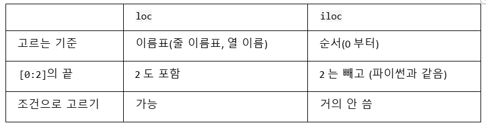
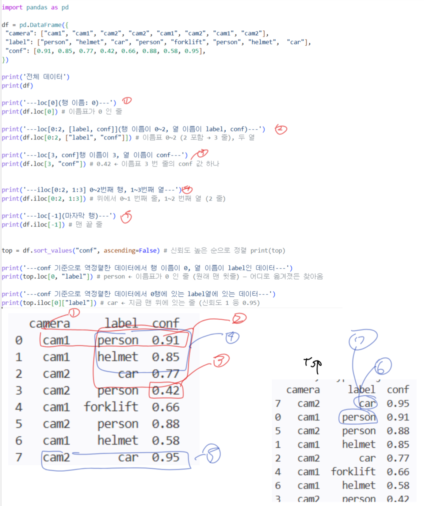

# 원하는 데이터만 고르기
- 표에서 필요한 행과 열만 꺼내는 방법
- 예제 데이터

열|뜻
---|---
time|탐지 시각
camera|카메라 이름
label|찾은 물체 종류
conf|신뢰도 (0~1, 높을수록 확실)
x1, y1, x2, y2|물체를 둘러싼 상자의 왼쪽 위·오른쪽 아래 좌표
latency_ms|처리에 걸린 시간 (밀리초)

## 열 고르기
- 열 하나만 인덱싱: `df[열_이름]`
- 열 여러개 인덱싱: `df[[열_이름1, 열_이름2, ...]]`
    - 열 여러개 쓰는 이유: 바깥 대괄호는 "골라주세요"를, 안쪽 대괄호는 "이 열들을"을 의미
```py
import pandas as pd 

df = pd.DataFrame({ 
 "camera": ["cam1", "cam1", "cam2", "cam2", "cam1", "cam2", "cam1", "cam2"],  "label": ["person", "helmet", "car", "person", "forklift", "person", "helmet",  "car"], 
 "conf": [0.91, 0.85, 0.77, 0.42, 0.66, 0.88, 0.58, 0.95], 
}) 

print(df["label"]) # 열 하나 → Series 
print(df[["label", "conf"]]) # 열 여러 개 → 표 (대괄호가 두 겹) 
```
```
0      person
1      helmet
2         car
3      person
4    forklift
5      person
6      helmet
7         car
Name: label, dtype: str
      label  conf
0    person  0.91
1    helmet  0.85
2       car  0.77
3    person  0.42
4  forklift  0.66
5    person  0.88
6    helmet  0.58
7       car  0.95
```

## loc와 iloc
- `loc`(location): 이름표로 고르기
- `iloc`(index location): 순서(인덱스)로 고르기
- 둘 다 [줄, 열] 순서로 쓴다. NumPy 의 [줄, 칸]과 같다


```py
import pandas as pd 

df = pd.DataFrame({ 
 "camera": ["cam1", "cam1", "cam2", "cam2", "cam1", "cam2", "cam1", "cam2"],  
 "label": ["person", "helmet", "car", "person", "forklift", "person", "helmet",  "car"], 
 "conf": [0.91, 0.85, 0.77, 0.42, 0.66, 0.88, 0.58, 0.95], 
})

print('전체 데이터')
print(df)

print('---loc[0](행 이름: 0)---')
print(df.loc[0]) # 이름표가 0 인 줄 

print('---loc[0:2, [label, conf]](행 이름이 0~2, 열 이름이 label, conf)---')
print(df.loc[0:2, ["label", "conf"]]) # 이름표 0~2 (2 포함 → 3 줄), 두 열 

print('---loc[3, conf]행 이름이 3, 열 이름이 conf---')
print(df.loc[3, "conf"]) # 0.42 ← 이름표 3 번 줄의 conf 값 하나 


print('---iloc[0:2, 1:3] 0~2번째 행, 1~3번째 열---')
print(df.iloc[0:2, 1:3]) # 위에서 0~1 번째 줄, 1~2 번째 열 (2 줄) 

print('---loc[-1](마자막 행)---')
print(df.iloc[-1]) # 맨 끝 줄 


top = df.sort_values("conf", ascending=False) # 신뢰도 높은 순으로 정렬 print(top) 

print('---conf 기준으로 역정렬한 데이터에서 행 이름이 0, 열 이름이 label인 데이터---')
print(top.loc[0, "label"]) # person ← 이름표가 0 인 줄 (원래 맨 윗줄) — 어디로 옮겨졌든 찾아옴 

print('---conf 기준으로 역정렬한 데이터에서 0행에 있는 label열에 있는 데이터---')
print(top.iloc[0]["label"]) # car ← 지금 맨 위에 있는 줄 (신뢰도 1 등 0.95)
```
```
전체 데이터
  camera     label  conf
0   cam1    person  0.91
1   cam1    helmet  0.85
2   cam2       car  0.77
3   cam2    person  0.42
4   cam1  forklift  0.66
5   cam2    person  0.88
6   cam1    helmet  0.58
7   cam2       car  0.95
---loc[0](행 이름: 0)---
camera      cam1
label     person
conf        0.91
Name: 0, dtype: object
---loc[0:2, [label, conf]](행 이름이 0~2, 열 이름이 label, conf)---
    label  conf
0  person  0.91
1  helmet  0.85
2     car  0.77
---loc[3, conf]행 이름이 3, 열 이름이 conf---
0.42
---iloc[0:2, 1:3] 0~2번째 행, 1~3번째 열---
    label  conf
0  person  0.91
1  helmet  0.85
---loc[-1](마자막 행)---
camera    cam2
label      car
conf      0.95
Name: 7, dtype: object
---conf 기준으로 역정렬한 데이터에서 행 이름이 0, 열 이름이 label인 데이터---
person
---conf 기준으로 역정렬한 데이터에서 0행에 있는 label열에 있는 데이터---
car
```

#### 그림으로 설명


## 조건으로 고르기
- NumPy의 마스크와 동일
```py
import pandas as pd 

df = pd.DataFrame({ 
 "camera": ["cam1", "cam1", "cam2", "cam2", "cam1", "cam2", "cam1", "cam2"],  
 "label": ["person", "helmet", "car", "person", "forklift", "person", "helmet",  "car"], 
 "conf": [0.91, 0.85, 0.77, 0.42, 0.66, 0.88, 0.58, 0.95], 
 "latency_ms": [32.5, 32.5, 41.2, 38.0, 29.8, 47.3, 30.1, 44.7], }) 


high = df[df["conf"] >= 0.8] # 신뢰도 0.8 이상인 줄만 print(high) 
print(len(high)) # 4 


mask = (df["label"] == "person") & (df["camera"] == "cam2") 
print(df[mask]) # cam2 가 찾은 person 
print(df[df["label"].isin(["car", "forklift"])]) # car 또는 forklift 인 줄 

print(df[df["latency_ms"].between(30, 40)]) # 30 이상 40 이하인 줄 

print(df.loc[df["conf"] >= 0.9, ["label", "conf"]]) # 조건과 열을 한 번에: loc[조건,  열] 

print(df.query("label == 'person' and conf >= 0.8")) # 조건을 문장처럼 쓰기
```
```
4
  camera   label  conf  latency_ms
3   cam2  person  0.42        38.0
5   cam2  person  0.88        47.3
  camera     label  conf  latency_ms
2   cam2       car  0.77        41.2
4   cam1  forklift  0.66        29.8
7   cam2       car  0.95        44.7
  camera   label  conf  latency_ms
0   cam1  person  0.91        32.5
1   cam1  helmet  0.85        32.5
3   cam2  person  0.42        38.0
6   cam1  helmet  0.58        30.1
    label  conf
0  person  0.91
7     car  0.95
  camera   label  conf  latency_ms
0   cam1  person  0.91        32.5
5   cam2  person  0.88        47.3
```

## 열 추가/수정/삭제
- 새 열은 이름을 정하면 대입해서 생김
- `df[새_열_이름] = [...]`
- 값 수정: `df.loc[조건, 열]=값`
- 값 삭제: `df.drop(columns=[])`

```py
import numpy as np 
import pandas as pd 

df = pd.DataFrame({ 
    "label": ["person", "helmet", "car", "person"], 
    "conf": [0.91, 0.85, 0.77, 0.38], 
    "x1": [120, 130, 300, 50], "y1": [80, 70, 200, 60], 
    "x2": [180, 170, 460, 90], "y2": [240, 110, 300, 200], 
    "latency_ms": [32.5, 32.5, 47.2, 38.0], 
}) 

print('original')
print(df);print()

pd.set_option("display.max_columns", None) # 열이 많아도 생략(...) 없이 모두 출력 
pd.set_option("display.width", 200) 

df["w"] = df["x2"] - df["x1"] # 상자 너비 
df["h"] = df["y2"] - df["y1"] # 상자 높이 
df["area"] = df["w"] * df["h"] # 상자 넓이 
df["is_slow"] = df["latency_ms"] > 45 # 느렸는지 True/False 
df["level"] = np.where(df["conf"] >= 0.8, "high", "low") # np.where(조건, 맞으면,  틀리면) 
df.loc[df["conf"] < 0.4, "level"] = "reject" # 조건에 맞는 줄만 값 바꾸기 — 반드시 loc 으로 


print('added w, h, area, is_slow & drop w, h & rename latency_ms to latency')
print(df) 

df = df.drop(columns=["w", "h"]) # 열 지우기 
df = df.rename(columns={"latency_ms": "latency"}) # 열 이름 바꾸기 
print(df.columns.tolist()) 
# ['label', 'conf', 'x1', 'y1', 'x2', 'y2', 'latency', 'area', 'is_slow', 'level'] 
```
```
original
    label  conf   x1   y1   x2   y2  latency_ms
0  person  0.91  120   80  180  240        32.5
1  helmet  0.85  130   70  170  110        32.5
2     car  0.77  300  200  460  300        47.2
3  person  0.38   50   60   90  200        38.0

added w, h, area, is_slow & drop w, h & rename latency_ms to latency
    label  conf   x1   y1   x2   y2  latency_ms    w    h   area  is_slow   level
0  person  0.91  120   80  180  240        32.5   60  160   9600    False    high
1  helmet  0.85  130   70  170  110        32.5   40   40   1600    False    high
2     car  0.77  300  200  460  300        47.2  160  100  16000     True     low
3  person  0.38   50   60   90  200        38.0   40  140   5600    False  reject
['label', 'conf', 'x1', 'y1', 'x2', 'y2', 'latency', 'area', 'is_slow', 'level']
```

## 정렬
- `df.sort_values(정렬할_열, ascending: bool)`
    - ascending=False로 지정하면 역순으로 정렬
- 인덱스 새로 정렬: `df.reset_index(drop=True)`

```py
import pandas as pd 


df = pd.DataFrame({ 
    "camera": ["cam1", "cam1", "cam2", "cam2", "cam1", "cam2", "cam1", "cam2"],  
    "label": ["person", "helmet", "car", "person", "forklift", "person", "helmet", "car"], 
     "conf": [0.91, 0.85, 0.77, 0.42, 0.66, 0.88, 0.58, 0.95], 
}) 

print('sorted(conf descending)')
print(df.sort_values("conf", ascending=False));print() # 신뢰도 높은 순 

print('sorted(camera-ascending, cofn-descending)')
print(df.sort_values(
    ["camera", "conf"], ascending=[True, False]
    )
);print() # 카메라별로 묶고, 그 안에서 신뢰도 높은 순 

print('conf top3')
print(df.nlargest(3, "conf")); print() # 신뢰도 상위 3 개 


result = df[df["conf"] >= 0.8]\
    .sort_values("conf").reset_index(drop=True)

print('sorted conf if conf >= 0.8')
print(result) # 줄 이름표가 0, 1, 2, 3 으로 새로 붙음 
```
```
sorted(conf descending)
  camera     label  conf
7   cam2       car  0.95
0   cam1    person  0.91
5   cam2    person  0.88
1   cam1    helmet  0.85
2   cam2       car  0.77
4   cam1  forklift  0.66
6   cam1    helmet  0.58
3   cam2    person  0.42

sorted(camera-ascending, cofn-descending)
  camera     label  conf
0   cam1    person  0.91
1   cam1    helmet  0.85
4   cam1  forklift  0.66
6   cam1    helmet  0.58
7   cam2       car  0.95
5   cam2    person  0.88
2   cam2       car  0.77
3   cam2    person  0.42

conf top3
  camera   label  conf
7   cam2     car  0.95
0   cam1  person  0.91
5   cam2  person  0.88

sorted conf if conf >= 0.8
  camera   label  conf
0   cam1  helmet  0.85
1   cam2  person  0.88
2   cam1  person  0.91
3   cam2     car  0.95
```