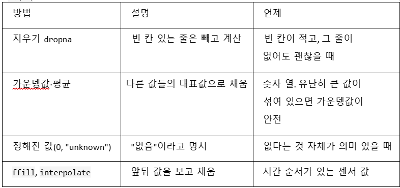

# 데이터 정제
- 실제 데이터에는 빈 칸, 두 번 적힌 줄, 숫자인데 글자로 적힌 값, 같은 것을 다르게 적은 값이 섞여 있다. 
- 이대로 요약하면 틀린 결과가 나오므로 먼저 손질한다. 
- 실제 분석 작업 시간의 대부분이 여기에 든다. 

## 빈 칸 찾기
- `df.isna()`: 칸마다 비엇으면 True
- `df.isna().sum()`: 열마다 빈칸 개수
- `df.isan().mean()`: 열 마다 빈칸 비율
- `df[df.isna().any(axis=1)]`: 빈 칸이 하나라도 있는 줄

```py
import numpy as np 
import pandas as pd 

df = pd.DataFrame({ 
    "label": ["person", "car", "person", "helmet", "car"], 
    "conf": [0.91, np.nan, 0.42, 0.85, np.nan], 
    "latency_ms": [32.5, 41.2, np.nan, 30.1, 44.7], 
}) 

print('isna')
print(df.isna()) # 칸마다 비었으면 True 
print()

print('isna.sum()')
print(df.isna().sum()) # 열마다 빈 칸 개수: label 0, conf 2, latency_ms 1 
print()

print('isna.mean()')
print(df.isna().mean()) # 열마다 빈 칸 비율: conf 0.4 (40%)
print()

print('isna.any(axis=1)')
print(df[df.isna().any(axis=1)]) # 빈 칸이 하나라도 있는 줄 

```
```
isna
   label   conf  latency_ms
0  False  False       False
1  False   True       False
2  False  False        True
3  False  False       False
4  False   True       False

isna.sum()
label         0
conf          2
latency_ms    1
dtype: int64

isna.mean()
label         0.0
conf          0.4
latency_ms    0.2
dtype: float64

isna.any(axis=1)
    label  conf  latency_ms
1     car   NaN        41.2
2  person  0.42         NaN
4     car   NaN        44.7
```

## 빈 칸(결측치) 처리하기
- 빈 칸이 있는 줄을 지울지, 대체할지 정하기
- 보통 값을 채울 때 전체평균, 중앙값, 주변값 등 상황에 맞춰서 사용. 정해진건 없음

```py
import numpy as np 
import pandas as pd 


df = pd.DataFrame({ 
    "label": ["person", "car", "person", "helmet", "car"], 
    "conf": [0.91, np.nan, 0.42, 0.85, np.nan], 
    "latency_ms": [32.5, 41.2, np.nan, 30.1, 44.7], 
}) 

print('---drop_all---')
print(df.dropna()) # 빈 칸이 하나라도 있는 줄을 지움 → 2 줄 남음 

print('---drop conf---')
print(df.dropna(subset=["conf"])) # conf 가 빈 줄만 지움 → 3 줄 남음 


# 원본 건들지 않기 위해 따로 copy
filled = df.copy() 
filled["latency_ms"] = filled["latency_ms"].fillna(filled["latency_ms"].median()) #  가운데값으로 채우기 
filled["conf"] = filled["conf"].fillna(0) #  0 으로 채우기 
print('---fill latency_ms to mean and conf to 0---')
print(filled) 

```
```
---drop_all---
    label  conf  latency_ms
0  person  0.91        32.5
3  helmet  0.85        30.1
---drop conf---
    label  conf  latency_ms
0  person  0.91        32.5
2  person  0.42         NaN
3  helmet  0.85        30.1
---fill latency_ms to mean and conf to 0---
    label  conf  latency_ms
0  person  0.91       32.50
1     car  0.00       41.20
2  person  0.42       36.85
3  helmet  0.85       30.10
4     car  0.00       44.70
```

- 시간 순서대로 쌓이는 경우의 방법
- `series.ffill()`: 바로 앞의 값 보고 그대로 이어쓰기
- `series.interpolate()`: 앞뒤 값 사이를 고르게 채우기
```py
import numpy as np 
import pandas as pd 

s = pd.Series([1.0, np.nan, np.nan, 4.0]) 

print(s.ffill().tolist()) # [1.0, 1.0, 1.0, 4.0] ← 바로 앞의 값을 그대로 이어쓰기 
print(s.interpolate().tolist()) # [1.0, 2.0, 3.0, 4.0] ← 앞뒤 값 사이를 고르게 채우기 

```

```
[1.0, 1.0, 1.0, 4.0]
[1.0, 2.0, 3.0, 4.0]
```

#### 결측치 처리 방법


## 중복 처리
- 기록 중복되면 같은 줄 여러번 들어가고, 개수와 합계가 부풀려짐
```py
import pandas as pd

df = pd.DataFrame({ 
    "time": ["09:00:01", "09:00:01", "09:00:03", "09:00:03"], 
    "camera": ["cam1", "cam1", "cam2", "cam2"], 
    "label": ["person", "person", "car", "car"], 
    "conf": [0.91, 0.91, 0.77, 0.79], 
}) 

print('---duplicated list---')
print(df.duplicated()) # 앞에 똑같은 줄이 있으면 True 

print('---duplicated count')
print(df.duplicated().sum()) # 1 ← 완전히 똑같은 줄 수 

print('---drop duplicated---')
print(df.drop_duplicates()) # 4 줄 → 3 줄 

print('---drop subset duplicated---')
print(df.drop_duplicates(subset=["time", "camera", "label"])) # 이 세 열만 같아도 중복으로 보기 → 2 줄 

```
```
---duplicated list---
0    False
1     True
2    False
3    False
dtype: bool
---duplicated count
1
---drop duplicated---
       time camera   label  conf
0  09:00:01   cam1  person  0.91
2  09:00:03   cam2     car  0.77
3  09:00:03   cam2     car  0.79
---drop subset duplicated---
       time camera   label  conf
0  09:00:01   cam1  person  0.91
2  09:00:03   cam2     car  0.77
```


## 값의 종류 바로잡기
- 숫자가 글자로 저장되어있으면 계산 안됨
    - 수치 데이터는 숫자로 되어 있는지 확인 후 변경해 줄 것
```py
import pandas as pd 

df = pd.DataFrame({ 
    "time": ["2026-11-20 09:00:01", "2026-11-20 09:00:03", "2026-11-20 09:00:04"],  
    "count": ["12", "-", "3"], 
    "camera": ["cam1", "cam2", "cam1"], 
}) 

print('---incorrext df---')
print(df.dtypes) # 세 열 모두 글자(str) 
print(df['count'].sum()) # 12-3('12' + 'NaN' + '3')


# 타입 수정
df["time"] = pd.to_datetime(df["time"]) # 글자 → 날짜 
df["count"] = pd.to_numeric(df["count"], errors="coerce") # 글자 → 숫자 (못 바꾸는 값은 빈 칸) 
df["camera"] = df["camera"].astype("category") # 몇 가지 값만 반복되는 열 → 범주형 (메모리 절약) 

print('--modify to check incorrect data types')
print(df.dtypes) # time: datetime, count: float64,  camera: category 

print('---modified dataframe---')
print(df) 
print(df["count"].sum()) # 15.0 ← 이제 계산이 된다
```

## 글자 다듬기
- 글자 열에 `.str`을 붙이면 글자 작업 가능
```py
import pandas as pd 

df = pd.DataFrame({ 
    "label": ["person", "Person", " car", "helmet", "PERSON "],
    "resolution": ["640x480", "1280x720", "640x480", "1920x1080", "640x480"], 
}) 

print('---before str processing---')
print(df["label"].unique()) # 같은 person 이 여러 가지로 적혀 있다 
print(df["label"].value_counts()) 


# str 작업 처리
df["label"] = df["label"].str.lower().str.strip() # 모두 소문자로, 앞뒤 공백 지우기 

print('---after str processing---')
print(df["label"].value_counts()) # person 3, car 1, helmet 1 
print(df["label"].str.contains("er")) # "er"이 들어 있는지 (True/False) 

print(df["label"].str.len()) # 글자 수 
wh = df["resolution"].str.split("x", expand=True).astype(int) # "x"를 기준으로 잘라 두 열로 
wh.columns = ["width", "height"] 
print(wh) 

```
```
---before str processing---
<StringArray>
['person', 'Person', ' car', 'helmet', 'PERSON ']
Length: 5, dtype: str
label
person     1
Person     1
 car       1
helmet     1
PERSON     1
Name: count, dtype: int64
---after str processing---
label
person    3
car       1
helmet    1
Name: count, dtype: int64
0     True
1     True
2    False
3    False
4     True
Name: label, dtype: bool
0    6
1    6
2    3
3    6
4    6
Name: label, dtype: int64
   width  height
0    640     480
1   1280     720
2    640     480
3   1920    1080
4    640     480

```

## 사용자 규칙 정하기
- apply(함수명): 사용자가 직접 만든 함수로 규칙 정하기
```py
import numpy as np 
import pandas as pd 


conf = pd.Series([0.91, 0.42, np.nan, 0.66, 0.85]) 

def grade(c): 
    if pd.isna(c): # 빈 칸이면 
        return "unknown" 
    if c >= 0.8: 
        return "high" 
    if c >= 0.5: 
        return "mid" 
    return "low" 


print(conf.apply(grade).tolist()) # ['high', 'low', 'unknown', 'mid', 'high'] 
```
```
['high', 'low', 'unknown', 'mid', 'high']
```
- cut: 숫자 구간으로 나누기
- `cut(나눌_시리즈, 나눌_기준이_담긴_리스트,
나눌_결과, right)`
```py
import numpy as np 
import pandas as pd 

conf = pd.Series([0.91, 0.42, np.nan, 0.66, 0.85]) 
g = pd.cut(
    conf, 
    bins=[0, 0.5, 0.8, 1.0], 
    labels=["low", "mid", "high"], 
    right=False
)
 
print(g.tolist()) # ['high', 'low', nan, 'mid', 'high'] 
# 0 이상 0.5 미만 → low, 0.5 이상 0.8 미만 → mid, 0.8 이상 → high 

```
```
['high', 'low', nan, 'mid', 'high']
```