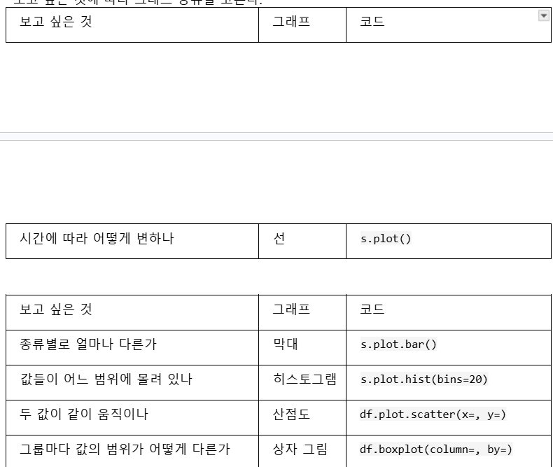
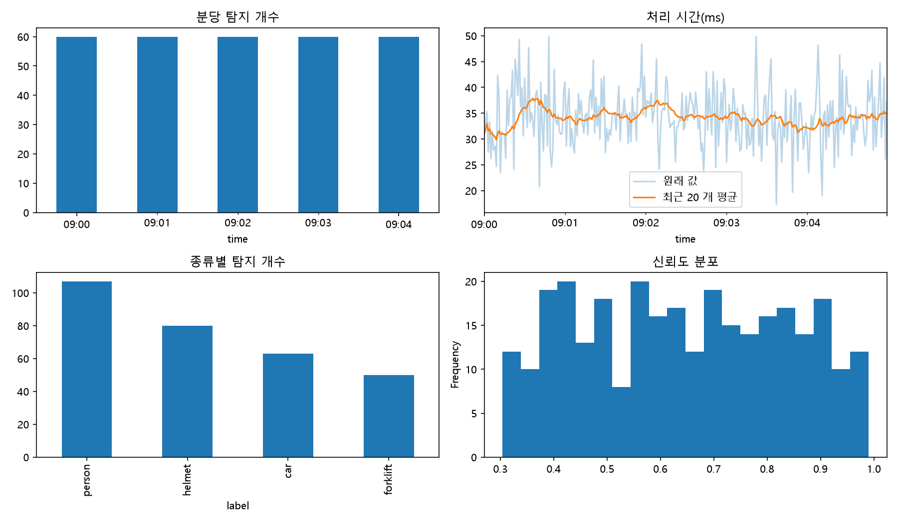

# 시간 데이터와 그래프
 - 시간(시계열) 데이터: 센서 값, 로그, 처리 속도 등 시간관련 정보가 담긴 데이터

 ## dt
 - df/seires.dt: 시계열 데이터로 취급
 ```py
 import pandas as pd 


t = pd.Series(pd.to_datetime(
    ["2026-11-20 09:00:01", "2026-11-20 09:05:30", "2026-11-20 10:12:45"]
)) 


print(t.dt.hour.tolist()) # [9, 9, 10] 몇 시 
print(t.dt.minute.tolist()) # [0, 5, 12] 몇 분 
print(t.dt.day_name().tolist()) # ['Friday', 'Friday', 'Friday'] 요일 
print(t.dt.strftime("%H:%M").tolist()) # ['09:00', '09:05', '10:12'] 원하는 모양의 글자로 
print(t.max() - t.min()) # 0 days 01:12:44 시간 차이 
print((t + pd.Timedelta(hours=9)).tolist()[0]) # 2026-11-20 18:00:01 9 시간 더하기

```
```
[9, 9, 10]
[0, 5, 12]
['Friday', 'Friday', 'Friday']
['09:00', '09:05', '10:12']
0 days 01:12:44
2026-11-20 18:00:01
```

## 시간을 행 이름표로
- df.set_index(행 이름)
```py
import pandas as pd 

df = pd.DataFrame({ 
    "time": pd.to_datetime([ 
    "2026-11-20 09:00:01", "2026-11-20 09:00:01", "2026-11-20 09:00:03", "2026-11-20 09:00:04", 
    "2026-11-20 09:00:06", "2026-11-20 09:00:07", "2026-11-20 09:00:09", "2026-11-20 09:00:10"]), 
    "label": ["person", "helmet", "car", "person", "forklift", "person", "helmet",  "car"], 
    "latency_ms": [32.5, 32.5, 41.2, 38.0, 29.8, 47.3, 30.1, 44.7], 
}) 

ts = df.set_index("time").sort_index() # 시간을 줄 이름표로 
print(ts) 
print(ts.loc["2026-11-20 09:00:05":"2026-11-20 09:00:09"]) # 5 초~9 초 사이 기록 (3 줄) 

```
```
                        label  latency_ms
time                                     
2026-11-20 09:00:01    person        32.5
2026-11-20 09:00:01    helmet        32.5
2026-11-20 09:00:03       car        41.2
2026-11-20 09:00:04    person        38.0
2026-11-20 09:00:06  forklift        29.8
2026-11-20 09:00:07    person        47.3
2026-11-20 09:00:09    helmet        30.1
2026-11-20 09:00:10       car        44.7
                        label  latency_ms
time                                     
2026-11-20 09:00:06  forklift        29.8
2026-11-20 09:00:07    person        47.3
2026-11-20 09:00:09    helmet        30.1
```

## resample: 시간단위로 묶어서 요약
- df.resample(시간단위)
```py
import pandas as pd 


df = pd.DataFrame({ 
    "time": pd.to_datetime([ 
    "2026-11-20 09:00:01", "2026-11-20 09:00:01", "2026-11-20 09:00:03", "2026-11-20 09:00:04", 
    "2026-11-20 09:00:06", "2026-11-20 09:00:07", "2026-11-20 09:00:09", "2026-11-20 09:00:10"]), 
    "label": ["person", "helmet", "car", "person", "forklift", "person", "helmet",  "car"], 
    "latency_ms": [32.5, 32.5, 41.2, 38.0, 29.8, 47.3, 30.1, 44.7], 
}) 


ts = df.set_index("time").sort_index() 

print(ts.resample("5s").size()) # 5 초마다 몇 개 찾았나 
# 09:00:00 4 ← 0~4 초 
# 09:00:05 3 ← 5~9 초 
# 09:00:10 1 ← 10~14 초 

print(ts["latency_ms"].resample("5s").agg(["mean", "max"]).round(1)) # 5 초마다 

```
```
time
2026-11-20 09:00:00    4
2026-11-20 09:00:05    3
2026-11-20 09:00:10    1
Freq: 5s, dtype: int64
                     mean   max
time                           
2026-11-20 09:00:00  36.0  41.2
2026-11-20 09:00:05  35.7  47.3
2026-11-20 09:00:10  44.7  44.7
```

## rolling
- df.series.rolling(초/개수, min_period).계산_메서드: '개'개수마다 한 칸씩 밀며 '계산_메서드' 계산 수행
```py
import pandas as pd 
lat = pd.Series([32.5, 32.5, 41.2, 38.0, 29.8, 47.3, 30.1, 44.7]) 
ma3 = lat.rolling(3, min_periods=1).mean().round(2) # 최근 3 개의 평균 
print(pd.DataFrame({"원래 값": lat, "최근 3 개 평균": ma3, "앞 값과 차이": lat.diff()}))
```
```
   원래 값  최근 3 개 평균  앞 값과 차이
0  32.5      32.50      NaN
1  32.5      32.50      0.0
2  41.2      35.40      8.7
3  38.0      37.23     -3.2
4  29.8      36.33     -8.2
5  47.3      38.37     17.5
6  30.1      35.73    -17.2
7  44.7      40.70     14.6
```

## 그래프 그리기
- df.plot(): matplotlib이 그래프 그려줌



```py
import numpy as np 
import pandas as pd 
import matplotlib.pyplot as plt 


plt.rcParams["font.family"] = "Malgun Gothic" # 맑은 고딕 (macOS 는 "AppleGothic") 
plt.rcParams["axes.unicode_minus"] = False # 마이너스(-) 기호 깨짐 방지 


# 연습용 기록 300 개 만들기: 1 초 간격, 처리 시간은 35ms 근처에서 흔들림 
rng = np.random.default_rng(0) 


df = pd.DataFrame({ 
    "time": pd.date_range("2026-11-20 09:00:00", periods=300, freq="1s"),  
    "camera": rng.choice(["cam1", "cam2"], 300), 
    "label": rng.choice(["person", "car", "helmet", "forklift"], 300, p=[0.4, 0.2,  0.25, 0.15]), 
    "conf": rng.uniform(0.3, 0.99, 300).round(3), 
    "latency_ms": rng.normal(35, 6, 300).round(1), 
}) 


ts = df.set_index("time") 
print(df.head()) 


per_min = ts.resample("1min").size() # 1 분마다 개수 
lat_ma = ts["latency_ms"].rolling(20, min_periods=1).mean() # 최근 20 개 평균 
print(per_min) 


fig, axes = plt.subplots(2, 2, figsize=(12, 7)) # 2×2 칸에 그래프 4 개 
per_min.plot.bar(ax=axes[0, 0], title="분당 탐지 개수") 


ts["latency_ms"].plot(ax=axes[0, 1], alpha=0.3, label="원래 값") # 연하게 
lat_ma.plot(ax=axes[0, 1], label="최근 20 개 평균", title="처리 시간(ms)") 
axes[0, 1].legend() # 범례 표시 
df["label"].value_counts().plot.bar(ax=axes[1, 0], title="종류별 탐지 개수") 
df["conf"].plot.hist(bins=20, ax=axes[1, 1], title="신뢰도 분포") 
plt.tight_layout() # 그래프끼리 겹치지 않게 간격 조절 

plt.savefig("./day6/code/s6_time/chart.png", dpi=150) # 그림 파일로 저장 (show 보다 먼저) 
plt.show() 

print("chart.png 저장 완료")

```
```
                 time camera   label   conf  latency_ms
0 2026-11-20 09:00:00   cam2  person  0.791        30.9
1 2026-11-20 09:00:01   cam2  person  0.882        32.7
2 2026-11-20 09:00:02   cam2  person  0.768        35.3
3 2026-11-20 09:00:03   cam1  helmet  0.554        27.5
4 2026-11-20 09:00:04   cam1  person  0.697        33.3
time
2026-11-20 09:00:00    60
2026-11-20 09:01:00    60
2026-11-20 09:02:00    60
2026-11-20 09:03:00    60
2026-11-20 09:04:00    60
Freq: min, dtype: int64
chart.png 저장 완료
```
